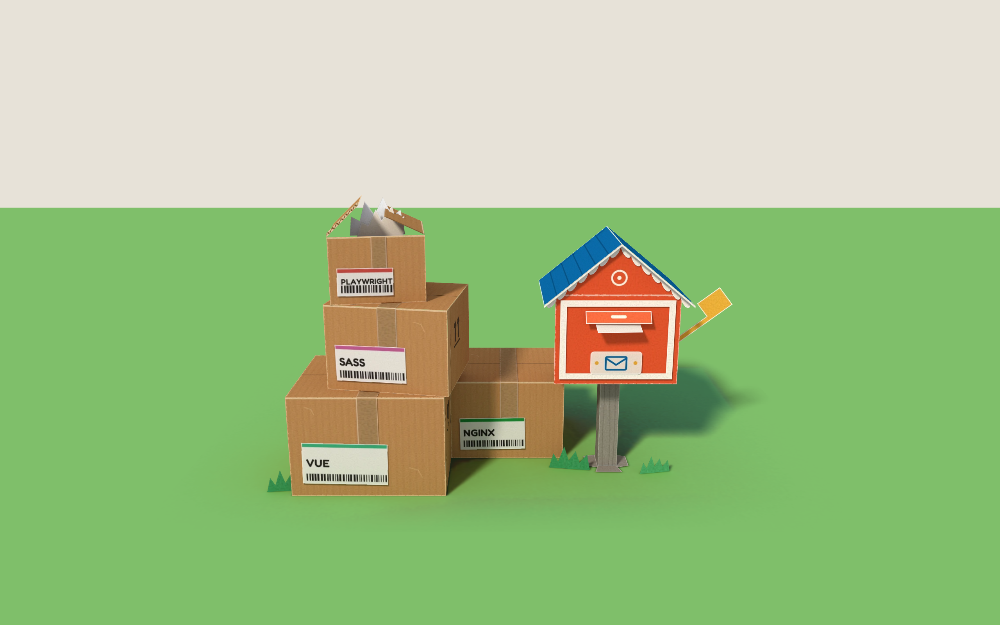
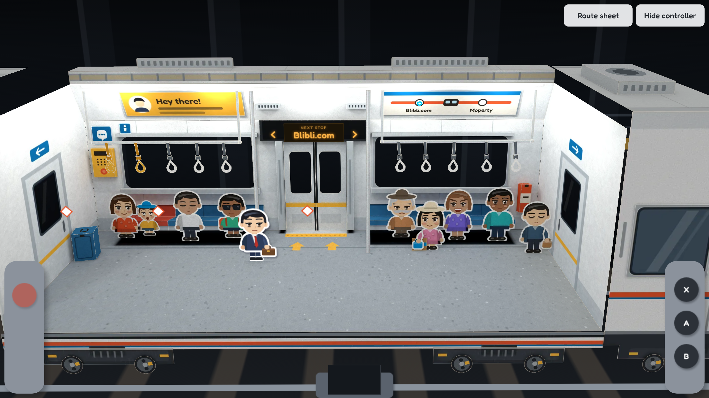
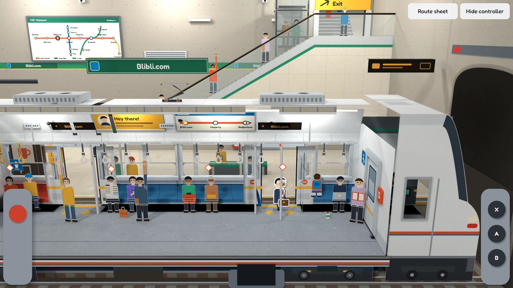

# Papercraft Art Bible

Target: a photographed miniature paper diorama. Every surface must be something you could cut from a real sheet. Depth, density and composition may learn from Paper Mario; all art stays original, with no Nintendo assets.

## Paper stocks

| Stock | Weight, feel | Core (cut edge) | Light through | Used for |
|---|---|---|---|---|
| Cover | 220gsm coated, smooth | White core shows at cuts | 8% | Printed objects: mailbox, signs, awnings, shop fronts, roofs |
| Kraft | 300gsm unbleached, faint flutes | Pale tan, zigzag rib on open edges | 4% | Parcels, cartons, anything shipped |
| Greyboard | 1.5mm chipboard, matte | Solid grey | 0% | Structure: posts, feet, stair stringers, belt frames, shelves |
| Bond | 120gsm uncoated | White | 30% | Labels, letters, receipts, tissue, catalog pages |
| Vellum | 60gsm tracing | Cream | 62% | Tape, windows, lamp shades, phone screens |
| Sugar | 160gsm dyed through, soft tooth | Same colour as face, never white | 16% | Foliage, grass, ground, simple single-piece objects |

White cut edges appear only on stocks with a white core. Sugar paper with a white outline reads as a sticker.

## Palette per space

Each space uses its base colours plus at most two accents. All values come from the existing art.

| Space | Base | Accents | Neutral |
|---|---|---|---|
| Street | Sky `#8fd3f4`, grass `#7fbf6a`, foliage `#3f9a5b` | Blibli blue `#0092da`, coral `#e8552d` | Cream `#fff4e2`, kraft `#b98450` |
| First-floor outlet | Brick `#d9a968`, planks `#c58c4d` | Blibli blue `#0092da`, sun `#f6b73c` | Cream `#fff4e2`, ink `#1d2228` |
| Second-floor store-room | Plank `#8f6f55`, concrete `#8b8275` | Coral `#e8552d`, mint `#35b58a` | Kraft `#b98450`, steel `#3d444e` |
| MRT car (home) | Shell `#e9edf1`, floor `#9aa3ad` | Seat blue `#2f6f9f`, livery coral `#e8552d` | Sun `#f6b73c` for safety yellow, steel `#3d444e` |
| Underground station | Concrete `#a8a39a`, granite `#d3ccbf` | Line teal `#2a8d6a`, sun `#f6b73c` | Steel `#5d6670`, stainless `#c9d0d6` |

Tech colours from `content.ts` appear only as small label bars.

## Edges and creases

- **Cut edge:** a 0.5-unit line of core colour inside the die line, on free pieces.
- **Fold:** a broken 1.1-unit crease line at 60% opacity. It must wobble and never read as a stroke.
- **Open corrugated edge:** a zigzag rib strip.
- **Glue:** carton joints are visible as an overlapping strip on the side wall. Foot tabs stay visible and pressed to the ground.

## Print style

- Flat ink only, in one or two colours per panel, with Fredoka for type.
- No printed gradients, printed shadows or printed highlights. Light is real or it is absent.
- Print detail is limited to what a real printer would put on the object: labels, handling arrows, bars, panel lines.
- Bars and arrows are decoration. Never print a number, tracking code, rating or result that `content.ts` does not state.

## Imperfection limits

- Labels: at most 1.2° off square.
- Stacked parcels: at most 9° yaw.
- Scuffs: at most two per face, at most 20% opacity, and only on kraft.
- Lifted flaps: 22–44°, and only where a story reason exists (the opened top parcel, the mail slot).
- No tears, stains or crumpling on anything carrying text.

## Light

One sun, defined once as `SUN_TO_LIGHT = [-.62, 1, 1]` in `src/light.ts`: upper left, in front of the scene. Ground shadows fall right and back by 0.62 and 1 per unit of height. Top and front faces are brightest, left faces are next, and right faces sit in ambient light and bounce. Blender bakes from this vector, so static objects and moving objects cannot disagree.

Sun colour is warm (1, .96, .9) with a 8° soft edge. Sky fill is cool, at strength .62.

## Composition

Every space follows one scene standard. It is not limited to shoeboxes: a space can be a room box, a street on a curved ring, or any other diorama shape the game needs.

### 1. Technique by role and distance

Split each space into the **main space**, where the courier walks and plays, and the **surroundings** that frame it. Judge each part of the surroundings from inside the main space: it is **open** if the eye travels far into it, and **enclosed** if something tall and close hems the space in. Which surface it sits on does not matter.

| Part | Build | In the Blibli spaces |
|---|---|---|
| Main space | Freestanding folds with real volume: boxes, tubes, ridge folds, slotted pairs, stacked contours. Slim or intricate outlines (people, bikes, scooters) are stand-up cut cards. The ground is flat sheets at slightly different heights. | Mailbox, parcels, bench, sandwich board, bins, lamps; showcase pedestal, tri-fold leaflet, price stand, basket, riser; reviewer's desk, camera, belts |
| Open surroundings | Many thin flat layers, one behind another, alternating pale and deep. Far detail is tiny flat print, and each layer carries its own small stories. They sit in the CSS backdrop when far enough. | Sky with sun, two cloud tones, balloons and birds; snow-capped mountains; hills dotted with trees; a far skyline with a broadcast tower and a crane; two mid-city rows of separately coloured blocks with water tanks, masts and billboards; a viaduct with trains; a mixed tree row; gabled houses. The street is also seen through every window |
| Enclosed surroundings | Relief fixed to its surface, sticking out toward the main space: half pieces on walls, hanging pieces on ceilings, low edges on floors. Anything with depth is **carved** relief (`carved` in `kit.ts`): real volume, painted onto the wall as the game camera sees it, so shelf lips, box ends and tops all show | Neighbouring shopfronts with recessed windows and folded awnings; pegboard, shelves, clock and frame on the shop walls; steel racking stocked with cartons, totes, crates, binders and rolls on the store-room side walls; high shelves under the roof slopes |

- Layered shadow-box work (flat cards stacked a little apart, flattened along the surface's normal by `relief`) is only for flat objects (posters, boards, frames, cards) and for open distant views. Never use it for objects with depth on a wall indoors, above all on side walls, where the camera sees them edge-on and they collapse into flat strips.
- One surface can be partly both: enclosure in front, the open view through its gaps. The alleys between the shops show the skyline; the windows show the street.
- The front edge frames the opening: the kerb, the road and its lamps outside; boxes and a plant indoors.
- Each kind of object has one design, used flat, in relief or freestanding.

### 2. Variants

- One base design per object type, varied by size, proportion, repeated parts (storeys, tiers), pose and small add-ons. The street's three neighbours are one `shopfront` recipe; the passers-by are one figure, flipped, recoloured and scaled to a child.
- Colours come from a narrow family per type. Phones use the three variant colours wherever they appear.
- Group in small clusters (a bench with a bike, a family of shoppers), not on an even grid, except where the subject is regular (shelves, belts), and then break it a little.

### 3. Realism

- Arrange it like a real place: everything rests on something, bases are hidden or anchored, and things sit where they would really be (hydrant at the kerb, scooter on the road, the clock on the wall).
- Show life and small stories: shoppers with bags, a delivery parked outside, a card on the review board still in the old theme with the paint cans beside it.
- Build from big to small: surroundings and ground, then main subjects, then props, then details that fill gaps.
- Make it obviously paper: grain, cut edges, creases; never photographic.

### The player and home: the morning commute

The player is a salaryman: white shirt, coral tie, navy suit, blue lanyard with an ID card, glasses and a briefcase, cut as one card with white core edges. Home is not a crossroads but one MRT car standing at an underground station, cut open along its near side like a cutaway model. It is the last car of its train: a neighbouring car past the left gangway, its own driving cab past the right end wall. The camera keeps the car's framing; the station (`src/art/scenes/station.ts`) is one deep side platform behind the car, closed by a concrete wall, and the station's end wall with the tunnel mouth past the cab. The platform is deep enough to hold its way out: an escalator rising along it to an exit deck at the back wall, and a glass lift. It shows over the roof, through every window and through the open doors. The car sits lower in the frame than other spaces (`camera.lift`, `liftTall` for portrait), so the frame ends just under the wheels; the camera pans a little further right than left, to show the cab and the tunnel.

| Part | Build in the MRT car and the station |
|---|---|
| Main space | Freestanding seated and standing passengers (one figure design in `people.ts`: seated, standing with an arm up to a strap or pole, kneeling), grab poles, the overhead rail with hand straps, glass draft screens, a buggy, a suitcase, a shopping bag, a coffee cup |
| Enclosed surroundings, the car | The car's own walls, all relief. Benches, the intercom, window sills, lips and jambs, door jambs and headers are carved on the back wall; the gangway and cab door frames and leaves, the emergency handles, the wheelchair plates and the extinguisher on the end walls; CCTV domes and speaker grilles on the cove. Ads, the line map and the next-stop display are flat, in frames |
| Enclosed surroundings, the station | The screen doors right behind the car (glass panes in a steel frame; their leaves slide with the car's doors). The wall closing the underside of the escalator and its exit deck carries carved relief: the up sign, an AED, the station map, a fire hose cabinet, a staff door, the customer service window with its counter, a top-up machine and a big lightbox. The concrete back wall (board marks, tie holes, a teal band with the station's name boards) carries the exit opening (a stainless frame and the Exit sign, the passage and its stair seen through it), lightboxes, a vent, wall lights, CCTV and the cable tray. The station's end wall with the tunnel mouth, the tunnel's dark lining with its lamps, the gate closing the platform. The overhead conductor rail the pantograph presses on; the trackbed and near rail under the wheels; the undercar equipment between the bogies |
| On the platform (freestanding) | Near the doors, seen through the windows: a drinks machine with a layered front and a coffee machine, a bench with two waiting, commuters at the screen doors, a student at the drinks machine. In the middle, rising over the roof: the escalator (sheared glass balustrades along the slope, grooved steps, riders), the exit deck with someone heading out, the glass lift with its cabin on the way up. A traveller with a suitcase, a cleaner with her trolley at the platform's end; hanging signs (station name, way out, next train) |
| Framing | The cut floor slab and underframe across the front, with the bogies on the rail; the roof cut and roof top with air-con housings and the pantograph; the neighbouring car past the left gangway and the cab past the right end wall as real shells (cut windows onto their interior: the next car's riders, the driver at his desk) |

The back wall, its relief and the station's end are drawn in the 3D context behind the stage (`behind`): they are the backmost things, and sorted with the near quads the browser would split and drop them.

Small stories: a commuter behind a newspaper, a student asleep on a backpack, a grandmother knitting, a mother with a child in a cap and a buggy, a schoolkid kneeling on the bench to look out, a laptop worker with his coffee on the floor, a reader with a book by the far gangway, a rider with headphones holding the pole. On the platform: a family waiting at the exit door, a student choosing a drink, an old man reading on the bench, a traveller with her suitcase, a cleaner at the end of the platform, the driver at his desk.

Everything seen agrees: the windows show the screen doors and the platform wall exactly where they stand, the neighbouring car's windows show its own riders, the train ends at the cab with the track running on into the tunnel, and the station's name on the hanging sign and the wall's band follows the line map.

The work scenes are stations. The line map on the cove picks one; the next-stop display over each door, the hanging name sign and the wall's name band show it. At the doors, A opens the car's doors and the screen doors together and the salaryman walks out onto the platform. He arrives at the destination's MRT entrance (a stair flight under a steel canopy and a station totem on Blibli street) and walks to its first stop. The way back boards the train at that station: the doors open, then close.

### The projects are played, not read

Neither floor carries a written account of the work. Each part of the work is an object you use. `encoded` in `content.ts` lists which stop acts out each fact.

| Stop | What you do | What it stands for |
|---|---|---|
| Showcase phone | A turns the phone through its three colours; the matching swatch chip pops up | Product detail: variant selection |
| Catalog paper | Opens the tri-fold leaflet: Specs, Promo, Shipping, Discussion and Description leaves, showing the colour you chose | Secondary pages for the mobile page |
| Price tag | A sticks the deal on: the price is struck through, a burst appears, the coupon is torn off | Promotions |
| Basket | Each A drops one boxed phone in; the fourth empties it | The simpler one-step add to cart |
| Recommended shelf | Grey placeholders fold away as you arrive; A turns to the next set | Recommendations, lazy loading |
| Instant camera | A prints the photo sideways; A again sets it upright on the review card | Photo upload, and the EXIF rotation bug |
| Review card | Each A adds a star | Writing a review as a reviewer |
| Photo gallery | A switches between a grid of square crops and a list of photos at their own shapes | Gallery with grid and list views; photos vary in ratio |
| Review board | Paper tabs filter it: all, with photo, five stars | Filter by photo or rating |
| Old-theme card and paint cans | Dressing | The redesign rolled out piece by piece |

Stops carry `focus` and `look`: the camera leans in on the object being used while the courier stands beside it, not in front of it.

### Outside and inside match

A room diorama is the building seen from the street, cut open. Every room's outline must match the exterior that holds it.

- The Blibli shop is a two-storey building with a gabled roof.
- The first-floor outlet is a rectangular room with a flat ceiling, because the second floor sits on it.
- The second-floor store-room is gabled, because it sits directly under that roof.
- Stairs go the way the floor goes. In the outlet they climb; in the store-room, the top floor, they go **down**: a notch in the front left of the floor, a balustrade on its open side, the wall handrail falling with the flight, and the cut floor slab showing the treads dropping toward the shop.
- The exterior is about 500 units tall so the whole roof stays in frame on the street camera. Rooms are drawn larger than the exterior scale, like any cutaway model.

## Pipeline

`npm run paper` rebuilds all four spaces. `npm run paper -- street 64` rebuilds one quickly at low samples. Set `BLENDER` and `CHROME` to the binaries when they are not in the macOS default locations, and `CYCLES_DEVICE=NONE` to bake on the CPU.

1. `src/art/kit.ts` holds the parts: panels, boxes, hinges, tabs, slots, layered decals and relief. `src/art/recipes.ts` turns data into objects and print layers. `src/art/scenes/` holds the three spaces as data.
2. Chrome renders each panel's stock, print, grain and edges into an albedo atlas.
3. Blender Cycles bakes light only, at half the atlas size (`LIGHT_SCALE`): each surface sees itself as white while bounce rays still take on the colours around it. Light is smooth by nature, so a low sample count is enough once `finish.py` smooths it within each panel.
4. `finish.py` multiplies the crisp print back over the light, lights the far backdrop evenly (nothing near can shade it), flattens decals and flat relief into their parents along the parent's normal, paints carved relief onto its wall along the game camera's rays (nearest piece wins), culls faces no game camera can see, and writes the atlas, backdrop and manifest. Far layers are packed last and cropped off the shipped atlas, so the backdrop can be cut at high resolution for free.
5. `PaperScene` in `src/art/fold.tsx` renders the manifest as `matrix3d` quads.

No AI image or 3D tool was used. All geometry is planar and generated from data.

## Performance budget

Measured on the worst case: software GPU, 4x CPU throttle, DPR 2.625, landscape.

- Textured layers cost far more than flat colour ones. Up to about 120 flat faces ran at 60fps, while 59 textured quads did not.
- The hard limit on the street is total fill, not quad count alone. Removing any one large layer recovered 60fps, while removing 11 small quads did nothing.
- Use relief for anything against a wall: real depth in Blender, no quad in the browser. Carved relief costs nothing extra in the browser either.
- Mark sheets with no cut-outs as opaque so the browser skips blending them.
- Anything far away and flat belongs in the CSS backdrop.
- Moving layers are paid for by area, every frame, even when they stand still. Merge flat layers that move together onto one sheet; print a thin thing (a mast) as small repeated pieces, never as a mostly transparent full-width sheet; never clip a moving print inside its sheet, slide a carrier of plain sheets instead.
- Far, wide sheets go in the 3D context behind the stage (`behind` on the panel). Sorted against the near quads, the planes of x-facing faces (end walls, machine sides) split them and the browser drops pieces.
- Keep tall sheets close to the top of the frame; and give wide floor sheets near the camera narrow tiles (the car floor uses 8), or portrait drops the tiles standing figures meet.
- Sheets that meet edge to edge (a floor on its front section, the track bed on the beam) need a hair of gap, and wide sheets near the camera need narrow tiles (400 for the track bed and beam): otherwise the browser drops pieces in portrait.

| Space | Quad limit, enforced by the journey test |
|---|---|
| Street | 130 |
| First-floor outlet | 75 |
| Second-floor store-room | 115 |
| MRT car and station | 170 (the moving outside, about 70 DOM sheets, is gone) |

Measured in the cloud container (software GPU, 4x CPU throttle, DPR 2.625), which runs slower than the reference machine: the street at 27 fps landscape and 44 portrait, and the MRT car with its old moving outside at 16 and 27 (the station replaced that outside; see the budget above). Unthrottled in the same container, the car walking past the deep station runs at about 15 fps landscape and 38 portrait, against 21 and 47 for the shallow first station: the deep platform's large back sheets and its escalator and lift each cost a few frames. Hidden floor and wall still cost drawing, so they are cut to what the camera can see.
- Sheets that only exist to move can merge once they stand still: the car's rail, hangers and twelve straps are one cut sheet.
- A slope's glass is a sheared sheet along the slope, not a rectangle around it.

Panels that swap with a toy (`show`) or ride a belt (`group`) are baked as phantoms: lit, but casting no shadow, so variants sharing a spot never shade each other and a belt box leaves no shadow where it no longer is. Hidden variants are not in the page, so they cost nothing.

## Motion

Paper moves in five stepped frames over .42s, never smoothly. Conveyor parcels advance in 60 steps per run. Under reduced motion, hinges jump straight to their end pose and belts stop.

| Stop | What moves |
|---|---|
| Mailbox | Slot flap lifts, letter slides out, flag tips |
| Delivery boxes | Top parcel flap opens |
| Enter the store | Both door leaves swing inward |
| Showcase phone | The chosen swatch chip rises |
| Recommended shelf | Placeholder cards fold down |
| Review board | The chosen filter tab rises |
| Any toy | A piece that appears drops into place in five stepped frames |
| Line map | The chosen station's lamp and the next-stop display switch |
| MRT doors | Both leaves of the exit door slide into the wall pockets, and the screen doors behind them slide open with them |

The train stands in the station; nothing in the MRT space moves smoothly.
