# Paper diorama checklist

What the owner of this project likes and dislikes in a paper diorama scene, taken from their own words across ten sessions and turned into 77 checks. Run a scene through every check before calling it done.

Each check is marked by where it comes from: **Said** (stated by the owner), **Approved** (the owner accepted a result that shows it), **Reading** (an interpretation that still needs the owner's confirmation).

This is not the whole standard: the owner twice listed faults with "including, but not limited to", so passing every check does not prove a scene meets it.

Screenshots come from the scenes themselves and from the two reference pages, Pinewood Valley and Paper Grove. Diagrams stand in for attached photos that could not be retrieved.

## 1. One coherent place

The scene is one real place with one theme. Everything in it belongs there, agrees with everything else, and is finished.

### 1.1 The scene follows one theme taken from one reference.

- [ ] **Said.** Pick one setting and keep every part of the scene inside it. Two references are two scenes, never one blend.
- Passes:
  - Pinewood Valley: pines, a camp, a river, snowy peaks. Every piece is from a pine valley.
- Fails:
  - Hanging foliage in the pine valley: fronds, vines, ivy and a leafy canopy that came from a jungle-camp reference.
- *Reading, to be confirmed:* In response I also turned two broadleaf trees into pines and removed a rope swing. You did not name those.

> You should remove those hanging foliage because that belongs to jungle, which is not really this scene. You mixed up the original pinewood landscape reference with jungle camp reference. Choose one
>
> (Pinewood Valley session, 5 Nov)

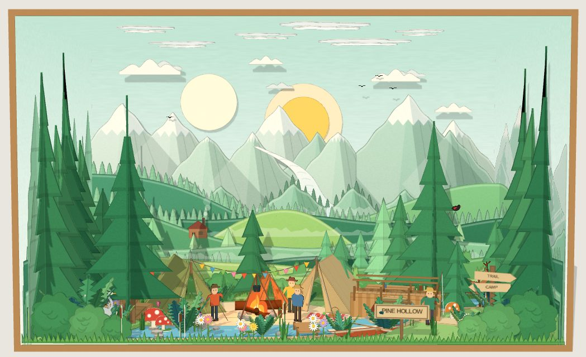

*Do. Pinewood Valley as published: one theme throughout.*

### 1.2 Every object has a reason to be in this particular place.

- [ ] **Said.** For each object, I must be able to say why it would be found here. If the only reason is "it fills the space" or "it adds variety", it comes out.
- Passes:
  - A shopping promenade: stalls, kiosks, palms, planters, café tables, flags, string lights, shoppers (the Blibli street you accepted).
- Fails:
  - Hot-air balloons in the sky and snow-capped mountains behind a shopping street.
- Attempts the owner has not judged yet:
  - The hometown green: picket fences, letter boxes, a town clock, a moving van.

> Consistency of objects to the theme and spaces, e.g baloon and mountains does not match a shopping district theme
>
> (Papercraft Game Scene 2, 6-7 Nov)

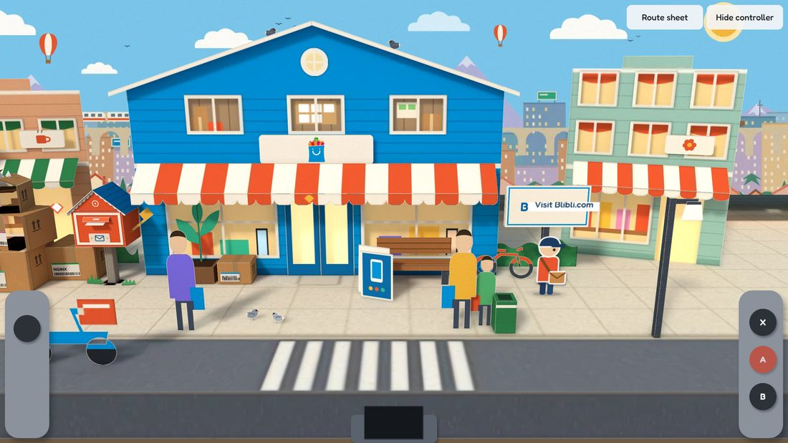

*Don't. Rejected: balloons and mountains behind a shopping street.*

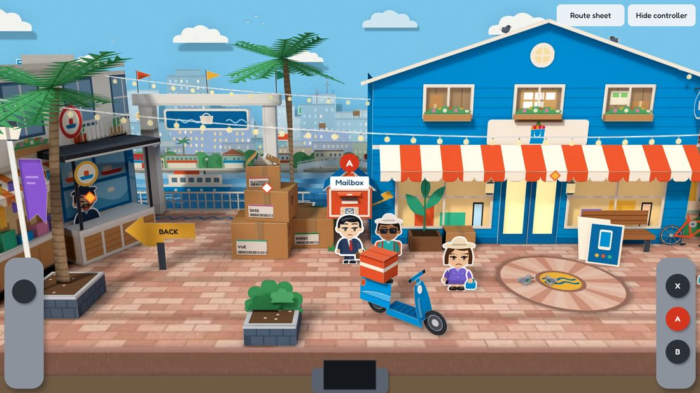

*Do. Accepted ("Yes, meets it"): everything belongs to a riverside promenade.*

### 1.3 Richness comes from things that belong, not from adding more kinds of things.

- [ ] **Said.** "Make it richer" never means "add anything". When asked for more variety, add more of what the place really has, and stop when the next addition would not make sense there.
- Passes:
  - Pinewood background at the version you called rich enough: peaks, a glacier, hills, partial pine woods, mist.
- Fails:
  - A bank of cloud behind the far mountains.
  - A canopy of pine boughs across the ceiling.
  - A strip of pine boughs across the top front edge.
- *Reading, to be confirmed:* You did not list the day-scene objects; I removed the hanging stars, the fireflies and the day/dusk/night switch. One thing I cannot explain: the cloud bank was already in the version you called "rich enough", and you had it removed later.

> you are taking "increase the variety of objects" too far and add objects that does not make sense at all. That is overfitting to the task, not generalizing my intent.
>
> (Pinewood Valley session, 5 Nov)

> Here are some objects that should be removed: Cloud bank; Focus on day scene. Remove objects that shouldn't be on day scene; ceiling pine canopy; pine bough valance
>
> (Pinewood Valley session, 5 Nov)

### 1.4 An outdoor scene is in daylight, with no night-only objects (stated for Pinewood Valley).

- [ ] **Said.** You said this about Pinewood Valley. Whether it holds for every scene is question 6. Indoor and underground scenes have no time of day.
- Fails:
  - Night-only objects in Pinewood Valley. You did not name them; I removed hanging stars, fireflies and the mood switch.

> Focus on day scene. Remove objects that shouldn't be on day scene
>
> (Pinewood Valley session, 5 Nov)

### 1.5 What is seen through any opening matches what really stands outside it.

- [ ] **Said.** Windows, doors, gaps and the far background must all show the same world.
- Passes:
  - The MRT car in the station you accepted: its windows show the screen doors and the platform wall exactly where they stand.
- Fails:
  - Train windows showing a city skyline while another train stands right beside the car.
  - Stairs on the second (top) floor that go up.
- Attempts the owner has not judged yet:
  - The Blibli shop's upstairs windows showing the store-room that is upstairs.
  - The store-room stairs turned to go down.
- *Reading, to be confirmed:* I extend this to buildings: inside and outside match in outline and floors. "Stairs on second floor goes up" I read as: the second floor is the top floor, so its stairs must go down.

> visual consistency of objects, structures and spaces, e.g train windows show the cities while another train is actually besides it.
>
> (MRT scene 2, 7 Nov)

> stairs on second floor goes up
>
> (Papercraft Game Scene 2, 6-7 Nov)

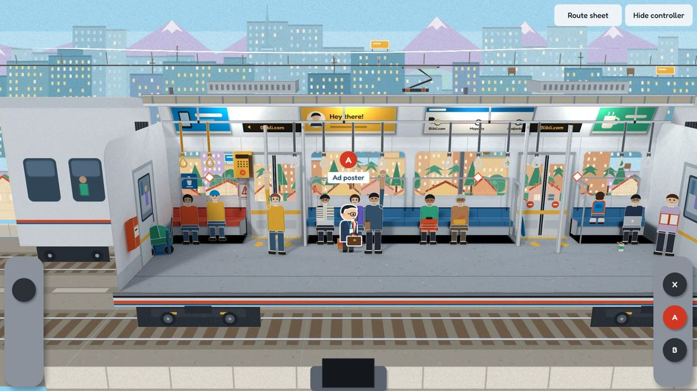

*Don't. Rejected: the first MRT. The windows show a city although the car stands in the open with other things beside it.*

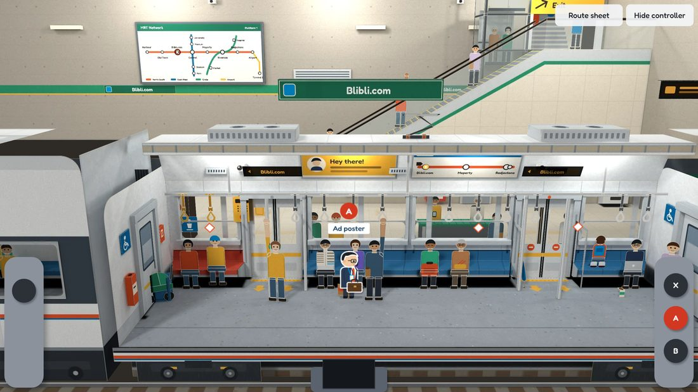

*Do. Accepted ("Looks good"): the car in an underground station; windows and surroundings agree.*

### 1.6 Nothing in the scene is left half-built.

- [ ] **Said.** Every structure that starts somewhere ends somewhere. No stairs that stop in mid-air, no wall without its other side, no object missing a part the camera can see.
- Fails:
  - The stairs on the first floor of the outlet, which were left unfinished.
- Attempts the owner has not judged yet:
  - The outlet stairs after my fix: a full flight with a handrail up to a landing and a lit doorway.

> Unfinished scene, e.g the stairs in outlet first floor
>
> (Papercraft Game Scene 2, 6-7 Nov)

*Don't. Before: the outlet with its stairs unfinished.*

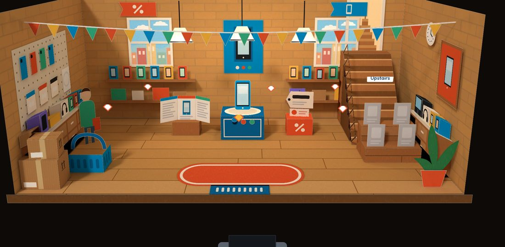

*Reference. My fix, not yet judged by you: the flight is complete.*

### 1.7 Nothing in the scene is misplaced or oddly positioned.

- [ ] **Said.** Three times you have named things as misplaced or weirdly positioned, each time without saying why.
- Passes:
  - The one tour boat left in the river view after the others were removed (the street was later accepted).
- Fails:
  - A sailing boat and a second boat in the river view ("misplaced").
  - The MRT structure in the hometown ("positioning looks weird"). Which structure you meant is question 5.
  - The buildings of the first street ("building placements in street").
- *Reading, to be confirmed:* My test: would this thing really be here, at this size, facing this way? For example a scooter on the road, a hydrant at the kerb, a clock on a wall.

> yes, it meets. but remove the sailing boat and another misplaced boat. also remove the bench near foreground
>
> (Papercraft Game Scene 3, 7-12 Nov)

> Remove the MRT structure. Its positioning looks weird.
>
> (Moperty session, 12-13 Nov)

> Objects placement and scene organization, e.g building placements in street
>
> (Papercraft Game Scene 2, 6-7 Nov)

*Don't. Removed at your request: the sailing boat and the small boats beside the tour boat.*

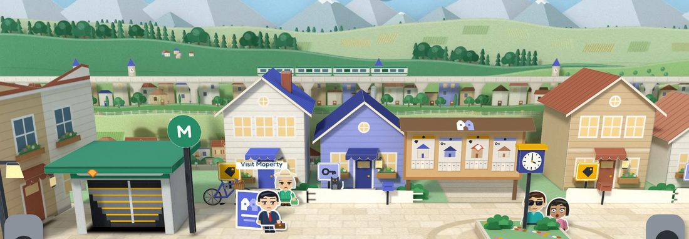

*Don't. Removed at your request: the MRT line across the valley.*

### 1.8 The scene has a layout of its own and does not repeat another scene's arrangement or signature feature.

- [ ] **Said.** You named two likenesses between the first hometown and the Blibli street: relief structures on the left and right bounds, and the open view in the same position as Blibli's gate. You also said not to use a river like Blibli's.
- Fails:
  - Hometown, first version: relief buildings left and right, and the open view at the back left, as in Blibli.
  - A river in the hometown valley.
- Attempts the owner has not judged yet:
  - Hometown, current version: homes close the middle of the back, the valley opens at both ends, nothing at the sides but trees.
- *Reading, to be confirmed:* I generalise this: before building, compare the plan of a new scene with every existing scene (where it is enclosed, where it opens, what the open view shows) and change it if it matches. Whether a river treated differently would be acceptable in another scene is not settled.

> the hometown square layout is very similar with Blibli, particularly: relief structure on left and right bounds; visible view position is exactly the same as blibli's docking gate
>
> (Moperty session, 12-13 Nov)

> Don't use river like blibli scene.
>
> (Moperty session, 12-13 Nov)

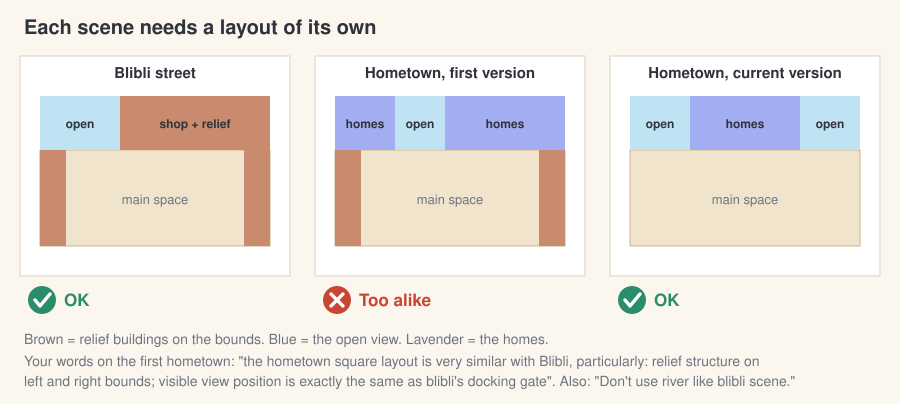

*Reference. Plan view of the three layouts.*

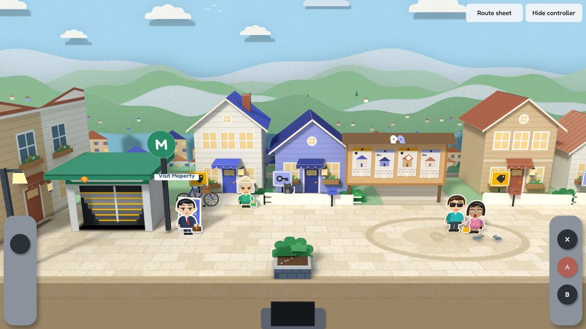

*Don't. Rejected for being too like Blibli: buildings left and right, view through one gap at the back left.*

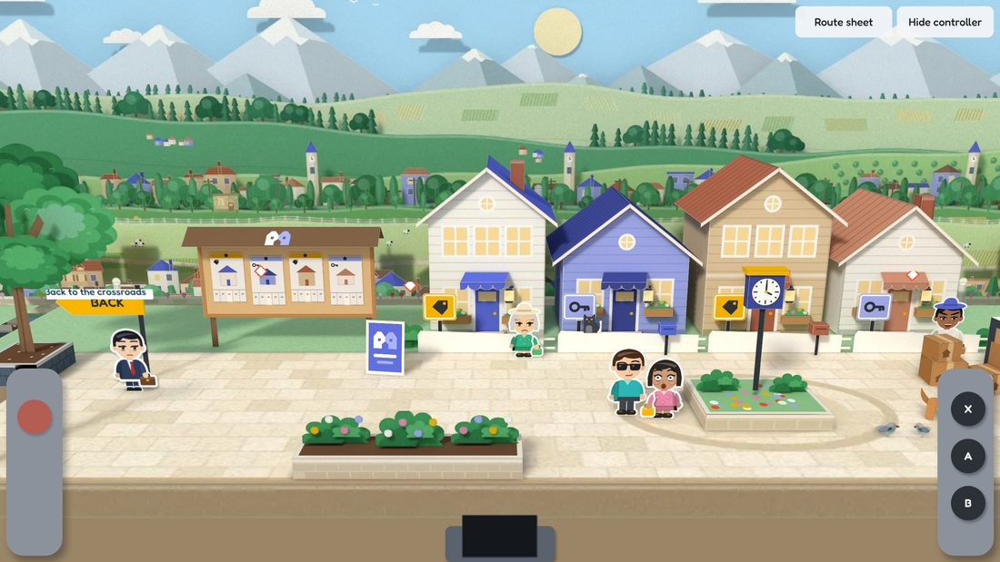

*Reference. Current version, not yet judged by you: homes in the middle, valley open at both ends.*

### 1.9 The concept chosen for the scene is not a boring one.

- [ ] **Reading.** You asked for the downtown block yourself, then judged that it "might be a boring concept" for Moperty and asked for creative options instead. You did not say what made it boring.
- Passes:
  - Blibli as a shopping place (accepted).
- Fails:
  - A downtown block with a sales gallery, for Moperty.
- *Reading, to be confirmed:* My test: a setting is boring when it could stand for any business. Your own first idea for Moperty, on 31 Oct, was "maps or towns". You accepted the hometown as a concept with "build it", but have not judged the built scene.

> After reviewing this, downtown might be a boring concept to represent moperty project.
>
> (Moperty session, 12-13 Nov)

> shopping-themed scene for blibli, maps or towns for moperty, nature and architectures for radjastone.
>
> (Joy-Con portfolio TV game, 31 Oct)

*Don't. Judged a boring concept for Moperty: the rebuilt downtown block.*

### 1.10 The scene is realistic as a place.

- [ ] **Said.** You name realism as one axis of your standard, beside details, scene organisation and object richness. You have not defined it further.
- *Reading, to be confirmed:* Checks 1.2, 1.5, 1.6 and 1.7 are how I test it: things belong, agree with each other, are finished and sit where they would be.

> (3) realistic-ness of a scene
>
> (Papercraft Game Scene, 6 Nov)

> keep looping to build and refine the scene until it achieves my standards on details, scene organization, object richness, scene realisticness, etc
>
> (MRT scene, 6 Nov)

## 2. The right technique in the right zone

A scene has a main space and surroundings. Each part is built with a different paper technique, chosen by what that part is, not by which side of the box it sits on.

### 2.1 The scene is divided into a main space and its surroundings, and each part of the surroundings is judged open or enclosed from inside the main space.

- [ ] **Said.** Stand in the main space and look outward. Where the eye travels far, the surroundings are open. Where something tall and close blocks the view, they are enclosed. The side of the box does not decide it.
- Passes:
  - Dense trees around a clearing enclose it, on any side.
  - A forest canopy encloses the ceiling.
  - A wall, a hill or a row of near buildings encloses a street.
- Fails:
  - Calling the back wall "open" and the side walls "enclosed" just because of where they are in the box.

> Enclosed views are about the scene surrounding the main space, not the diorama layout. Examples are dense trees surrounding the main space, high structures like walls, hills, buildings. Those can be anywhere in the diorama layout, e.g canopies of dense forest can enclose the ceiling.
>
> (Papercraft Game Scene, 6 Nov)

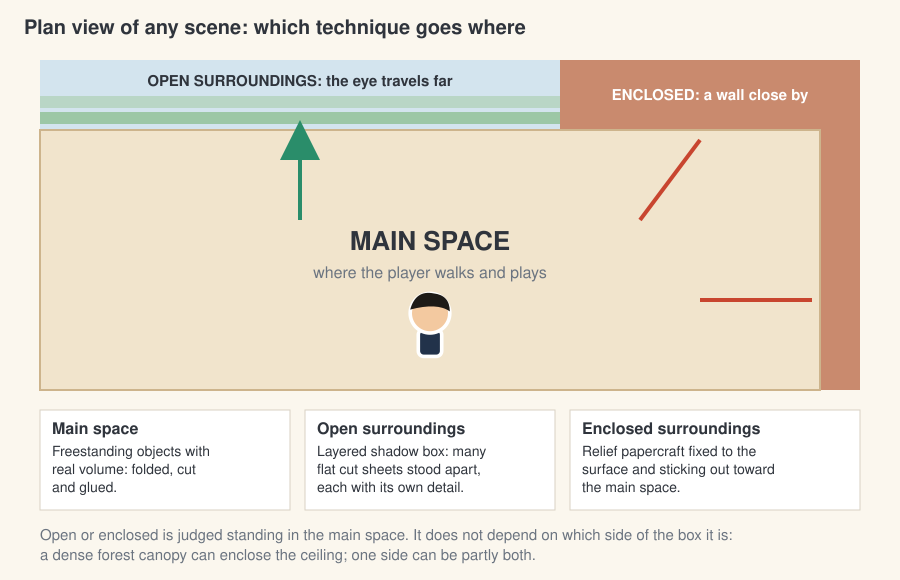

*Reference. Which technique goes where.*

### 2.2 The main space is filled mostly with freestanding 3D papercraft.

- [ ] **Said.** Where the player walks, objects stand on their own and have real volume: folded, cut and glued (see section 4). Flat layers are not the main technique here.
- Passes:
  - Pinewood Valley's camp: tents folded like tents, slotted pines, a log pile, a canoe, a picnic table.
- Fails:
  - A main space furnished with upright flat cut-outs only.

> more paper 3d papercraft on main space, layered shadow box for open-wide views, 3d papercraft that attaches to surfaces for enclosed views
>
> (Papercraft Game Scene, 6 Nov)

> I want a shoebox or container paper diorama scene, where rich combination of freestanding folded pop-up objects blends well to dense layered shadow box scene as the background
>
> (Pinewood Valley session, 5 Nov)

*Do. Freestanding folded objects in front, layered flat sheets behind.*

### 2.3 Open and distant views are built as a layered shadow box of flat cut sheets.

- [ ] **Said.** Anything the eye travels far into (a valley, a far bank, a skyline, the sky) is made of flat sheets stood one behind another. For a near part of the view, such as the river and a ship, you allowed a second route: deepen the box so it becomes real 3D space. You asked me to try both and keep the better-looking one; the layered route won and you accepted it.
- Passes:
  - The Blibli river view: water bands, a boat, the far bank, shops, trees, towers, each on its own sheet.
- Fails:
  - A far bank, a city and a river printed together on one card.

> Objects near enclosed views are shown in relief papercraft. Open and distant backgrounds are shown with layered flat objects (see reference)
>
> (MRT scene 2, 7 Nov)

> Lack of layered flat objects to show open and distant views
>
> (Start of Downtown 2, 7 Nov, about the first downtown build)

> container box depth increased so river and ship become part of 3d space; or include the river and ship as layered flat backgrounds; select better-looking one
>
> (Papercraft Game Scene 3, 7-12 Nov)

*Do. The Blibli river view before (one printed card) and after (layered sheets with shadows between them). You accepted the after.*

### 2.4 Enclosed surroundings carry relief papercraft attached to their surface.

- [ ] **Said.** A wall, a facade or any close bounding surface is dressed with pieces that have real depth and stick out toward the main space: awnings, balconies, shelves, cabinets, signs, lamps, half-objects against the wall. This ties the objects to the box.
- Passes:
  - Blibli promenade: the white waterfront building, the red café and the shop front, with awnings, balconies, window boxes and lanterns ("now much better").
- Fails:
  - A street whose buildings are flat fronts with nothing standing off them.
  - The first MRT box: no relief on any side.
- Attempts the owner has not judged yet:
  - The store-room after my fix: steel racking stocked with cartons, totes, crates and rolls on the side walls.

> Minimum use of relief papercraft object to add cohesiveness with bounding container / box surfaces, especially if boundings are designed for enclosed views like walls, near-structures, etc, e.g none in any side of current scene's box
>
> (MRT scene 2, 7 Nov)

> Relieved papercraft usage on container sides are now much better.
>
> (Papercraft Game Scene 3, 7-12 Nov)

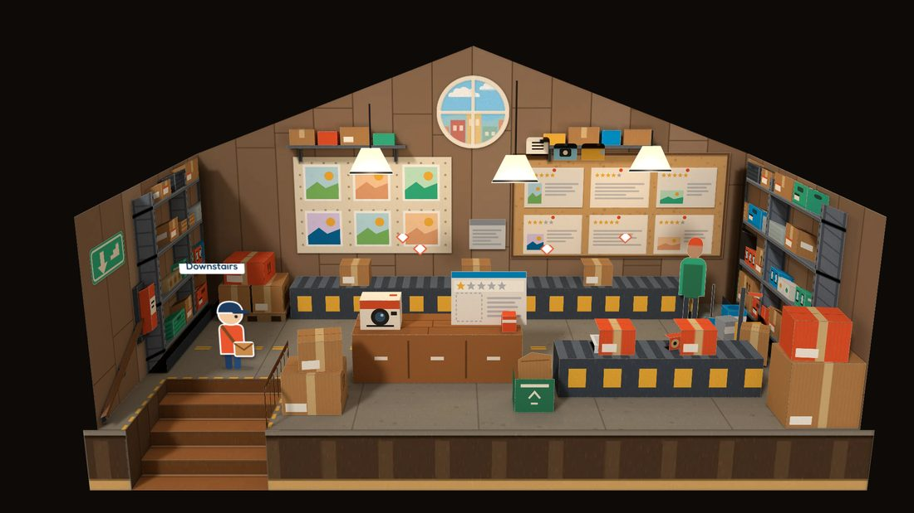

*Reference. My fix, not yet judged by you: racking with real depth on the store-room side walls.*

### 2.5 Flat layered cards are never used for objects with depth on an indoor wall, above all a side wall.

- [ ] **Said.** Layering flat cards is for things that are flat (posters, boards, frames) and for distant views. Shelves, cabinets, racks and anything with volume on an indoor wall are relief with real depth.
- Passes:
  - Posters, a pegboard, a clock and a framed print as flat layers on a shop wall.
- Fails:
  - Store-room side walls built as stacked flat cards standing in for shelving.

> side walls in outlet stockroom apply layered shadow box rather than relief papercraft. Layered shadow box diorama is for flat objects or emphasize distant backgrounds, not for indoor especially for side walls.
>
> (Papercraft Game Scene 2, 6-7 Nov)

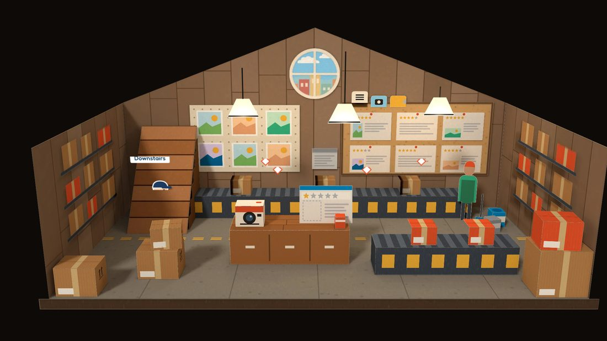

*Don't. Rejected: side-wall shelving as flat layered cards, and too few, too similar objects.*

### 2.6 Where the surroundings are enclosed, the relief is on the left and right bounds as well as the back.

- [ ] **Said.** If a scene is enclosed on a side, that side gets relief. A street enclosed by buildings has relief buildings on its left and right, not only a back wall. (See the open question in section 10 about scenes that should not be enclosed at the sides at all.)
- Passes:
  - Blibli promenade: relief buildings on the left, the right and the back right.
- Fails:
  - A street with relief only on the back.
  - The first downtown build, whose left, right and back bounds lacked relief.
- *Reading, to be confirmed:* Downtown 2 then added relief buildings on both sides and a relief back wall, and you still rejected it. So relief at the sides is needed where a scene is enclosed, and is not enough on its own. See question 1.

> shopping street scene can be designed with relief papercraft structures on left and right bounding surfaces too, not just on the back.
>
> (Papercraft Game Scene 2, 6-7 Nov)

> Lack of relief papercraft objects to blend with container left, right and background bounding boxes
>
> (Start of Downtown 2, 7 Nov, about the first downtown build)

*Do. Relief buildings close the Blibli promenade on the left and right.*

### 2.7 The share of freestanding objects, relief and flat layers fits the kind of scene.

- [ ] **Said.** There is no fixed ratio. It depends on the scene: indoor or outdoor, enclosed outdoor or open-wide landscape.
- Passes:
  - Pinewood Valley: a deep layered valley, pines against the side walls, a folded camp in front.
- *Reading, to be confirmed:* How I apply it: an indoor room is mostly relief and freestanding objects; an enclosed outdoor place mixes all three; a wide-open landscape is mostly flat layers.

> The ratio between using folded pop-up objects and layered shadow box background depends on the scene itself, e.g indoor or outdoor, enclosed outdoor or open-wide landscape, etc.
>
> (Pinewood Valley session, 5 Nov)

### 2.8 The background continues onto the side and top surfaces of the container.

- [ ] **Said.** The back, the sides and the top are one surrounding. Enclosed sides get more folded pop-up objects, some with parts attached or flattened against the wall. Open sides get more flat layers. An open sky on top is flat layered clouds.
- Passes:
  - Pinewood Valley: the valley wraps round the corners; pines stand against the side walls; the ceiling is open sky with flat clouds.
- Fails:
  - Side walls and ceiling left as plain painted card.
- *Reading, to be confirmed:* You had Pinewood's ceiling pine canopy removed, and a day later said a dense forest canopy can enclose a ceiling. I read that as: Pinewood's sky is meant to be open. See question 11.

> In a shoebox scene like this, background spans and continue to sides and top surface of the shoebox scene.
>
> (Pinewood Valley session, 5 Nov)

> if the scene sides are enclosed with trees and grasses, then more folded pop-up objects should be added on the sides. Some objects typically have parts attached or flatten on the shoebox side surface. If sides are like an open field, then layered shadow box should be used more to emphasize wide background. The same goes with top surface. If it is an open sky, then layer it with flat clouds
>
> (Pinewood Valley session, 5 Nov)

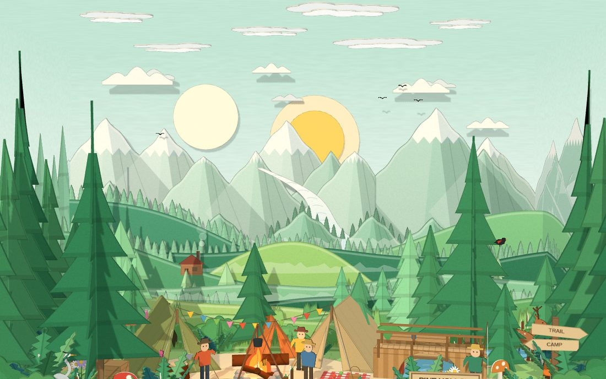

*Do. Pinewood Valley: tall pines against the side walls, flat clouds across the open sky.*

### 2.9 The container is as deep and wide as the scene needs, even when the playable area stays the same.

- [ ] **Said.** If relief or structures do not fit, make the box deeper or wider behind and beside the walk area. For Moperty you also allowed a larger playable space and a camera that stands further back.
- Passes:
  - A deeper MRT platform so the escalator and the lift fit behind the car (accepted).
- Fails:
  - Squeezing relief into a shallow box, or leaving it out for lack of room.
- Attempts the owner has not judged yet:
  - The hometown green: wider and deeper, with the camera pulled back.
- *Reading, to be confirmed:* "Further camera zoom is allowed" I took to mean the camera may show more of a larger space. It could also mean closer in.

> If space is insufficient, depth and width of the scene container can be added too without increasing the playable area, e.g to add more relief structures in shopping street scene.
>
> (Papercraft Game Scene 2, 6-7 Nov)

> add more depth to the container so the platform is wide enough and can contain structures like the escalator and elevators for exit
>
> (MRT scene 2, 7 Nov)

> The playable space can be enlarged and further camera zoom is allowed.
>
> (Moperty session, 12-13 Nov)

### 2.10 An indoor scene uses its walls, floor and ceiling to pack the space densely.

- [ ] **Said.** Rooms are bounded on purpose. The walls carry relief, things hang from the ceiling, and objects stand close together the way a real shop or store-room is stocked.
- Fails:
  - A room drawn as an open floor with a few props far apart.
- Attempts the owner has not judged yet:
  - The outlet: pegboard, shelves, bunting, a showcase, a basket and a price stand within one room.

> Use bounds for indoor scenes like this store to increase spatial density. Examples from Paper Mario
>
> (Joy-Con portfolio TV game, 31 Oct)

*Reference. The outlet as it stands, not yet judged by you.*

### 2.11 The container shape suits the scene; it does not have to be a shoebox.

- [ ] **Said.** A playable scene may use other diorama forms, such as curved or circular walls, when they serve the place.

> Because papercraft-game branch is playable, different types of diorama like circular walls can be used, not just shoebox diorama.
>
> (Papercraft Game Scene, 6 Nov)

## 3. The layered open-view background

This is the part you have corrected most often. A good background is layered, varied, detailed, visibly deep and on theme.

### 3.1 The open view is many separate cut sheets, never one printed picture.

- [ ] **Approved.** Each band of the view (water, a bank, a row of buildings, a tree line, a ridge, clouds) is its own sheet with its own cut outline along the top.
- Passes:
  - Blibli river view after the rebuild: five water bands, the far bank, shops, trees, flats, towers, three city rows, two cloud rows.
- Fails:
  - The far bank as one strip of printed buildings with one blue band for the river: it reads as a poster pinned to the back.

> Flat objects for open and distant views, like structures across river, should have some layered depth to improve scene richness. See the example image
>
> (Papercraft Game Scene 3, 7-12 Nov)

> yes, it meets.
>
> (Papercraft Game Scene 3, 7-12 Nov, on the layered river view)

*Do. Before and after. You accepted the layered version.*

### 3.2 The layers differ in kind, not only in distance.

- [ ] **Said.** Depth alone is not richness: the layers must have variety.
- Passes:
  - Faceted mountains with a lit face, a shaded face and jagged snow caps.
  - A hill that sweeps in from one side and stops.
  - A rounded mound that does not span the width.
  - Woods that cover only part of a ridge.
  - A pale glacier winding between two ranges.
- Fails:
  - Fourteen rolling ridges of the same shape, each a step darker.
- *Reading, to be confirmed:* What variety meant in practice comes from my reading of your landscape photo, built into the version you then called "rich enough": the examples under Passes, with bright and deep values alternating instead of fading steadily.

> The variation of foreground objects are sufficient, but the layered shadow box in the background is only deep, without variety. Look at the example of layered shadowbox landscape to see what I mean by rich variety.
>
> (Pinewood Valley session, 5 Nov)

> This version is already rich enough
>
> (Pinewood Valley session, 5 Nov, on the rebuilt background)

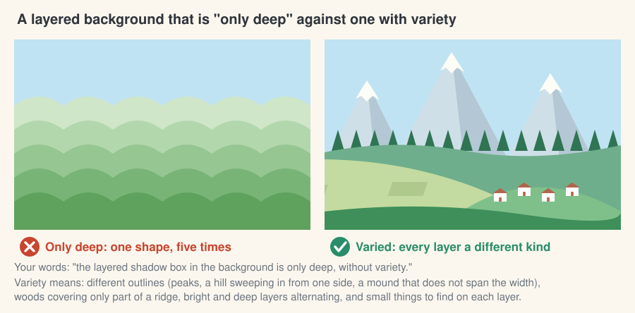

*Reference. Only deep, against varied.*

*Do. Pinewood Valley's background as published: peaks, a glacier, sweeping hills, partial woods, a mound.*

### 3.3 Every flat piece in the background carries its own detail and differs from its neighbours.

- [ ] **Said.** A flat sheet is not a plain silhouette. It carries cut and toned detail, and repeated things on it vary. Without that the background looks unfinished.
- Fails:
  - The first hometown valley: plain ridge shapes dotted with identical tiny houses and triangles.
- Attempts the owner has not judged yet:
  - Trees in more than one kind, each cut in two tones.
  - Buildings that differ in roof, chimney, windows and colour.
  - Fields as striped patches on a slope; a hamlet on a hillside; a road winding over a hill.
  - A lit strip along each crest where the cut edge catches the light.

> The flat papercraft objects for the open view background are lacking details and variations. The layer depth is also very minimum. This makes it look half-baked and not polished
>
> (Moperty session, 12-13 Nov)

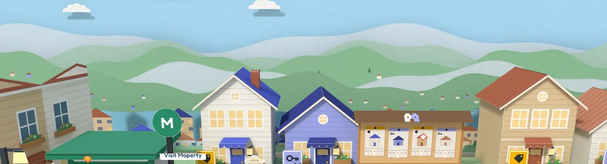

*Don't. Rejected as half-baked: plain ridges, identical dots, almost no depth.*

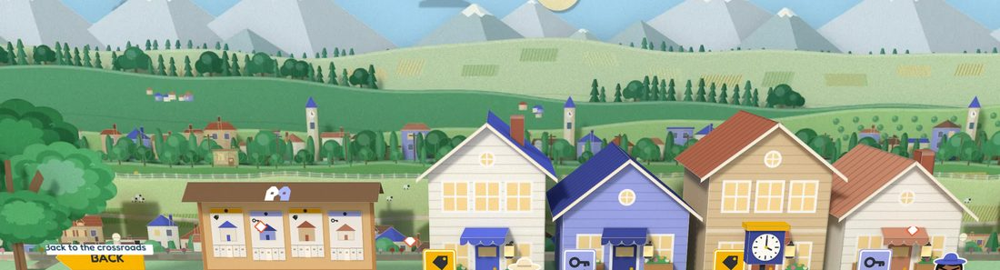

*Reference. My rebuild, not yet judged by you: varied layers with detail on each.*

### 3.4 The depth between the layers is plain to see, not minimal.

- [ ] **Approved.** You said the hometown's layer depth was "very minimum". What you accepted on the Blibli river view: more than ten layers, stood far enough apart that each casts a visible soft shadow on the next.
- Passes:
  - Blibli river view: each layer throws a visible shadow sliver on the one behind.
- Fails:
  - Layers so close that the shadows are hairlines and the view reads as one flat print.
- *Reading, to be confirmed:* "Layer depth" could mean the gap between layers, the number of layers, or the depth of the whole stack. I test all three. See question 12.

> The layer depth is also very minimum.
>
> (Moperty session, 12-13 Nov)

> yes, it meets.
>
> (Papercraft Game Scene 3, 7-12 Nov, on the river view with visible shadows between its layers)

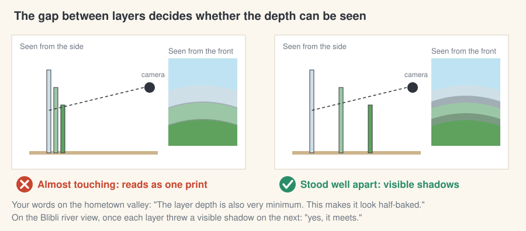

*Reference. Why the gap matters.*

### 3.5 Things that sit in the view stand between layers, on their own sheets.

- [ ] **Approved.** A boat, a bridge, a train: each is its own piece standing between two layers, not printed onto one of them.
- Passes:
  - The tour boat riding between two water bands (accepted).
- Fails:
  - Boats, trees or buildings printed onto the water or the hill sheet.
- *Reading, to be confirmed:* From the standard I wrote from Pinewood Valley, which you adopted: a tree line is its own sheet just behind the ridge it grows on, in a value that contrasts with that ridge.

> yes, it meets.
>
> (Papercraft Game Scene 3, 7-12 Nov, on the layered river view)

### 3.6 The background is rich and still entirely on theme.

- [ ] **Said.** You asked for a richer distant background and then rejected the balloons and mountains that were added to it. Both hold: the background must be full, and everything in it must belong to the place (items 1.2 and 1.3).
- Passes:
  - Behind a riverside promenade: the far bank, waterfront shops, a footbridge, city offices.
- Fails:
  - A thin, empty distance.
  - A full distance padded with things from elsewhere.

> distant background on outdoor scene is not rich enough
>
> (Papercraft Game Scene 2, 6-7 Nov)

> baloon and mountains does not match a shopping district theme
>
> (Papercraft Game Scene 2, 6-7 Nov)

### 3.7 When you give a reference "to see what I mean", I take the quality from it and do not copy its design.

- [ ] **Said.** Said about the Pinewood Valley background as a reference for the hometown. Elsewhere you have asked for a scene "like in the picture", so this is about that kind of reference, not every one.
- Passes:
  - Learning from Pinewood Valley that layers should vary in kind, then drawing a farm valley for the hometown.
- Fails:
  - Rebuilding Pinewood Valley's peaks, glacier and pine woods behind the hometown.

> refer to background of https://claude.ai/artifact/3PivfiN1j2qNZq2DVAuX5c to see what I mean, but don't copy that design
>
> (Moperty session, 12-13 Nov)

### 3.8 The background holds what the brief names: nothing more, and nothing you asked for is taken out.

- [ ] **Said.** The MRT station changed three times. First you asked for a rich composition with elevators, vending machines "or another platform in the distant background". Then: keep it simple "for initial design", one platform with a concrete wall, not another platform. Then: more depth so the escalator and elevators for the exit fit.
- Passes:
  - MRT: one platform with a concrete wall; later a deeper platform with an escalator and a lift.
- Fails:
  - A far platform, a gallery, a concourse and a mural after you said simple.
  - Taking out the escalator and lift to make it simple, when you had named them.

> show rich composition of objects and structures in the train, like elevators, vending machines or another platform in the distant background.
>
> (MRT scene 2, 7 Nov)

> lets keep the station background simple for initial design, one platform with concrete wall in the background, not another platform. the train is the last / first car
>
> (MRT scene 2, 7 Nov)

> add more depth to the container so the platform is wide enough and can contain structures like the escalator and elevators for exit
>
> (MRT scene 2, 7 Nov)

*Do. The accepted station: one platform, a concrete wall, exit structures behind.*

## 4. Freestanding objects

Objects standing in the main space are paper models: a folded body with cut pieces glued on. Flat cards are the exception, in three named cases.

### 4.1 Each freestanding object is a folded volume with cut pieces glued onto it.

- [ ] **Said.** Build the object the way a paper kit does. The body is folded (a tent fold, a box, a tube, two slotted cards). Smaller parts are separate cut pieces glued on.
- Passes:
  - Fox: the body is one sheet folded over the spine with the legs cut from its lower edge; the head is a card glued across the front; the tail is a card glued behind.
  - Pine: two identical die-cut cards crossed at right angles.
- Fails:
  - A bicycle, a scooter, a bush or a pigeon as one upright flat cut-out standing in the open.
- *Reading, to be confirmed:* Following the recipe is not enough by itself. Downtown 2 had slotted pines and a dog and pigeons folded like the fox, and you called its objects badly designed. The Blibli scooter, bicycle, pigeons, bushes and chairs were rebuilt this way, and you never judged them on their own.

> Freestanding objects that I typically like is combination of folded and arrangement of cut papers glued together, like the fox and pine trees in https://claude.ai/artifact/D52gc9dtiTQWzgPrxe88nv . Flat objects are allowed too if the objects are placed near surfaces, structures, or the object naturally plane-shaped, or intentional (humans). details of flat objects emphasized through color tones.
>
> (Papercraft Game Scene 3, 7-12 Nov; repeated in Downtown, 6-7 Nov and Downtown 2, 7 Nov)

> keep looping to refine the objects like the bicycle on the walkable scene
>
> (Papercraft Game Scene 3, 7-12 Nov)

> keep looping and refining the paper objects (apply folding + cutting + gluing techniques for freestanding objects, colors for flat objects), object placements and organization, and enrich the layered open-view background
>
> (Moperty session, 12-13 Nov)

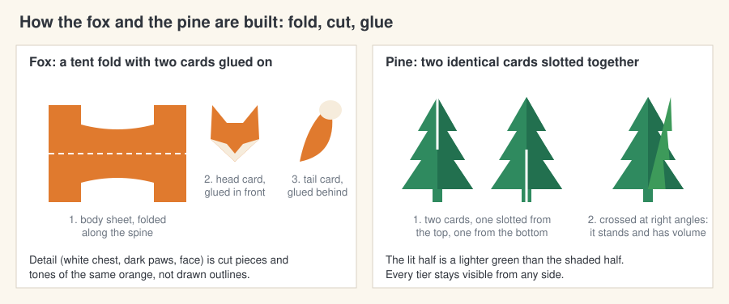

*Reference. How the fox and the pine are made.*

*Do. Paper Grove: the fox and the pines you pointed to. The other animals are on the same page; you did not name them.*

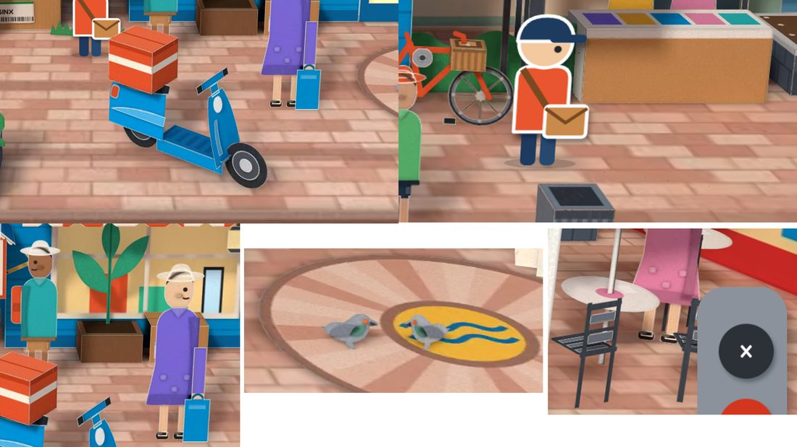

*Reference. The Blibli street objects rebuilt by the recipe. Not judged by you on their own.*

### 4.2 The scene is not made of single flat stickers.

- [ ] **Said.** Paper diorama objects have depth: real faces, thickness and folds. On 31 Oct you allowed a single flat piece for "simple objects and the playable character". On 7 Nov you gave the three cases in 4.4, which I treat as the current rule. Whether a simple object standing in the open may still be flat is question 19.
- Passes:
  - A folded storefront, folded parcels, a mailbox with a flap that lifts.
- Fails:
  - Shelves, a conveyor and banners all drawn as flat cards.

> Papercraft diorama objects have depth, not just a single paper sticker for everything
>
> (Joy-Con portfolio TV game, 31 Oct)

> A single papercraft piece is for simple objects and the playable character, adopting Paper Mario.
>
> (Joy-Con portfolio TV game, 31 Oct)

### 4.3 Each freestanding object has variety of shape, depth and detail.

- [ ] **Said.** An object is more than its simplest outline. It has several parts at different depths, and those parts differ in shape and tone.
- Passes:
  - A tree with a trunk that forks into branches and leaf clusters cut separately, set at different depths and in different greens.
  - A palm with a ringed trunk and fans of fronds at different headings.
- Fails:
  - A tree as one trunk and one round blob.
  - A row of identical plain boxes.

> Standing paper-folded / cut 3d objects lacks variety of shape, depth and detail. Look at trees in referenced image to see what I mean.
>
> (Papercraft Game Scene 2, 6-7 Nov)

> Freestanding paper-folded / cut 3d objects lacks variety of shape, depth and detail. Look at trees example for reference
>
> (MRT scene 2, 7 Nov)

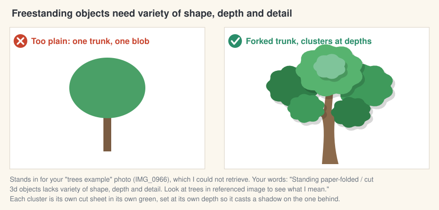

*Reference. What the trees example asks for.*

### 4.4 A flat card is used only where one of your three cases applies.

- [ ] **Said.** Flat is allowed when the object (a) is placed near a surface or structure, (b) is naturally plane-shaped, or (c) is flat on purpose, which means people. Anything else standing in open space is folded.
- Passes:
  - A bench against a shop wall; birds on a roof ridge.
  - A sign, a flag, a wheel, a table top, a fence, a poster.
  - Every person, including the player.
- Fails:
  - A lone flat tree, bush, vehicle or animal in the middle of the walk area.
- *Reading, to be confirmed:* "Near" I take to mean touching or overlapping a wall, a facade or a larger object as seen from the game camera. Anything with clear ground all round it is folded.

> Freestanding objects that I typically like is combination of folded and arrangement of cut papers glued together, like the fox and pine trees in https://claude.ai/artifact/D52gc9dtiTQWzgPrxe88nv . Flat objects are allowed too if the objects are placed near surfaces, structures, or the object naturally plane-shaped, or intentional (humans). details of flat objects emphasized through color tones.
>
> (Papercraft Game Scene 3, 7-12 Nov)

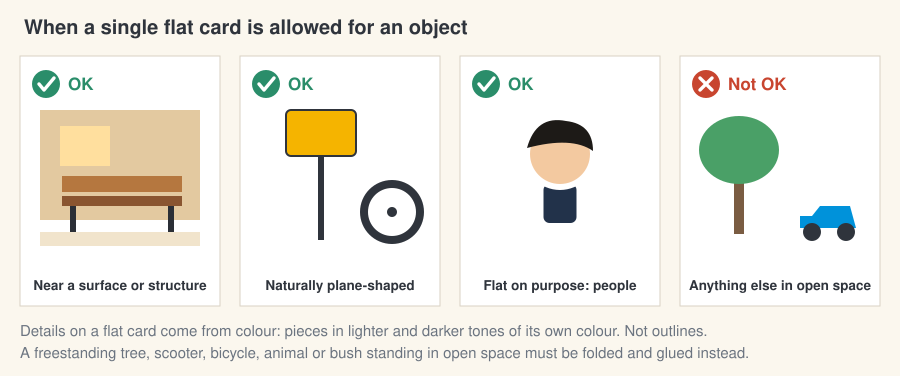

*Reference. The three allowed cases and the one that is not.*

### 4.5 Detail on flat pieces is made with colour tones.

- [ ] **Said.** Details on a flat object are brought out with colour tones. Your latest wording: "colors for flat objects".
- Passes:
  - The accepted Blibli cast.
- *Reading, to be confirmed:* How I apply it: separate pieces in lighter and darker tones of the object's own colour, no drawn outlines, no see-through printed shading. You have not judged that treatment itself.

> details of flat objects emphasized through color tones.
>
> (Papercraft Game Scene 3, 7-12 Nov)

> keep looping and refining the paper objects (apply folding + cutting + gluing techniques for freestanding objects, colors for flat objects), object placements and organization, and enrich the layered open-view background
>
> (Moperty session, 12-13 Nov)

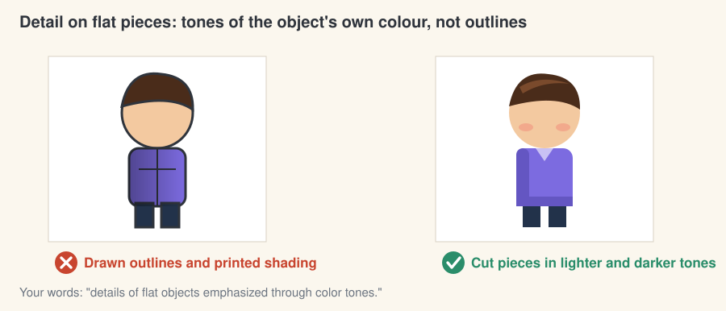

*Reference. Outlines against tones.*

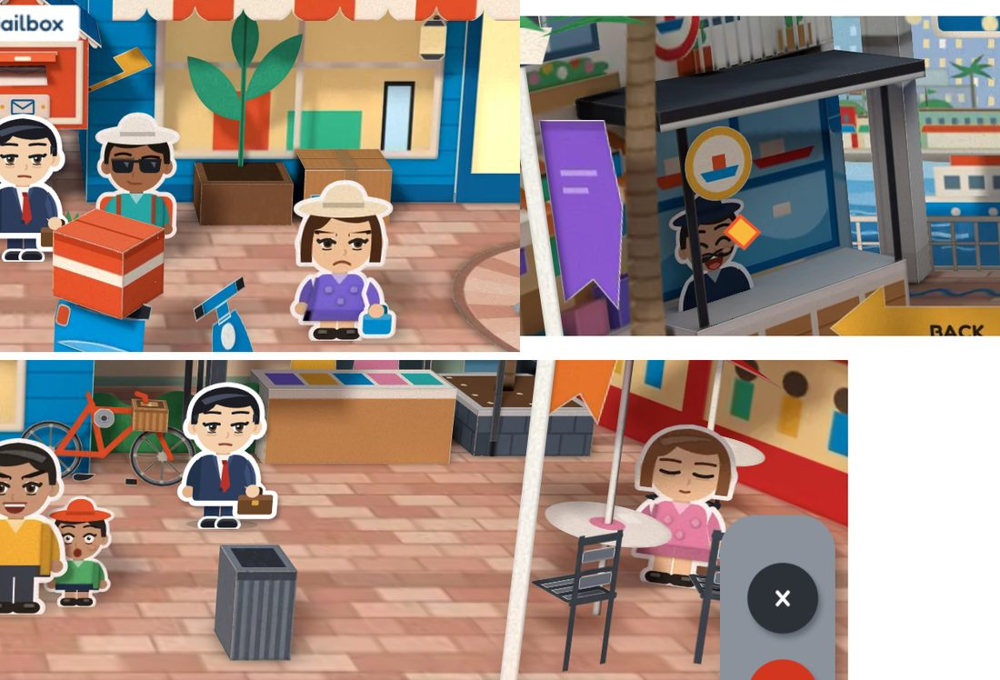

*Do. The accepted Blibli cast: detail from tones.*

### 4.6 There are enough objects, and objects of one kind vary.

- [ ] **Said.** A space must not look sparse, and the objects in it must vary.
- Passes:
  - Pinewood Valley's foreground, which you called sufficient.
- Fails:
  - The first store-room: a few similar cartons with empty floor between them.
- Attempts the owner has not judged yet:
  - The store-room after my fix: cartons, totes, crates, phone boxes, binders, tape rolls and label rolls on the racks.
- *Reading, to be confirmed:* From the standard I wrote and you adopted: one base design per kind of object, varied in size, proportion, colour within a narrow family, pose and small add-ons.

> outlet stockroom objects are not variative enough and too sparse
>
> (Papercraft Game Scene 2, 6-7 Nov)

> The variation of foreground objects are sufficient
>
> (Pinewood Valley session, 5 Nov)

*Don't. Too sparse, too similar.*

*Reference. My fix, not yet judged by you: more kinds, more of them.*

### 4.7 The paper objects are ambitious: none is a flat sticker, and each interactive one has a moving paper part of its own.

- [ ] **Said.** Said about the first Blibli world, where everything was a flat card.
- Passes:
  - Your examples: a letter pulled out of the mailbox and shown close up; a computer that rates the product in its tray with stars.
- Fails:
  - Shelves, a conveyor and banners drawn as flat cards.
- Attempts the owner has not judged yet:
  - Drawers that slide, flaps that hinge, a home whose front swings open.

> Direction is correct but be more ambitious in creating the papercraft objects in the environment.
>
> (Joy-Con portfolio TV game, 31 Oct)

### 4.8 No object is "badly designed" in the way the Downtown 2 objects were.

- [ ] **Reading.** You said the Downtown 2 objects were badly designed without naming which. That build included objects made by the fox and pine recipe (slotted pines, a tent-folded dog and pigeons, folded boxes). My guesses, to be confirmed: vehicles and site pieces reduced to bare boxes, stiff tall people unlike the paper-toy cast, a flat crane and scaffold dominating the view, signs piled on one another, and folded animals that are hard to read from the game camera.
- Fails:
  - The Downtown 2 block as a whole.

> "Paper Salaryman - Downtown 2" does not meet the standard at all. Scene organization is a mess and objects are badly designed.
>
> (Moperty session, 12-13 Nov)

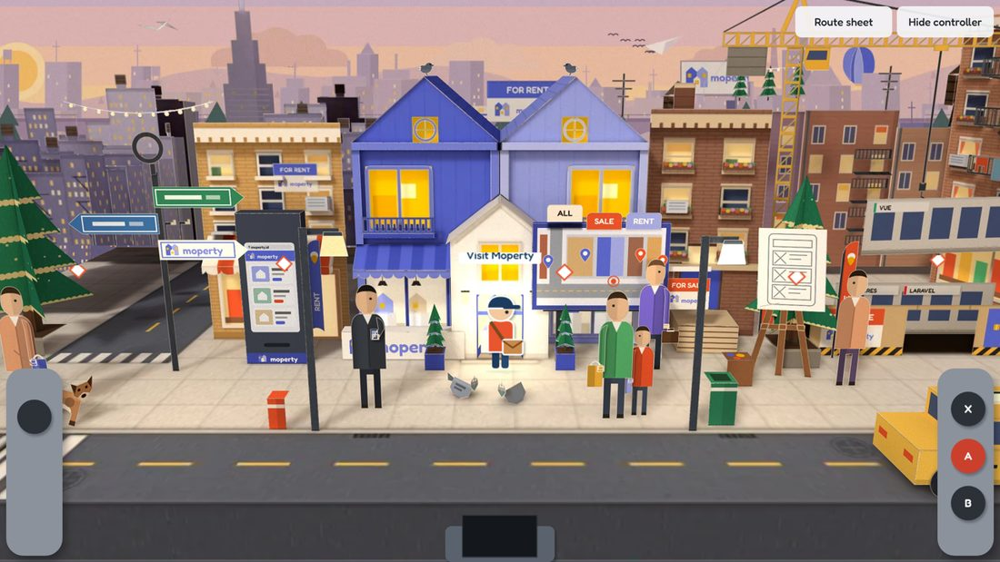

*Don't. Downtown 2, judged a mess with badly designed objects.*

## 5. Placement and organisation

Objects are placed for a reason, form one scene with the container, and never get in the way of each other.

### 5.1 No object is placed at random, and the scene holds together as one.

- [ ] **Said.** Every object is where it is because of something next to it. The scene reads as one place, not a collection of items.
- Passes:
  - A café table with its chairs under a parasol beside the café (Blibli, accepted).
- Fails:
  - The first downtown build: "Objects randomly placed", "Lack of cohesion".
  - Downtown 2, which regrouped the props into small scenes and was still "a mess".
- Attempts the owner has not judged yet:
  - Moving day at the last home on the hometown green: a van, cartons, a mover, a child watching.

> Lack of cohesion in the scene
>
> (Start of Downtown 2, 7 Nov, about the first downtown build)

> Objects randomly placed
>
> (Start of Downtown 2, 7 Nov, about the first downtown build)

> Scene organization is a mess
>
> (Moperty session, 12-13 Nov)

*Don't. Downtown 2: "Scene organization is a mess".*

*Do. Blibli promenade, accepted: objects grouped around the shop, the gate and the café.*

### 5.2 The scene has a clear arrangement that can be described in one sentence.

- [ ] **Reading.** My reading of "organisation", to be confirmed: there is one anchor (the shop, the train car, the row of homes), a few groups around it, and clear ground between the groups. If I cannot describe the arrangement in a sentence, it is a mess.
- Passes:
  - "A brick plaza closed by shops on three sides, the Blibli shop as its anchor, the river through a gate at the back left."
- Fails:
  - A list of twenty things with no anchor.

### 5.3 Nothing blocks a thing that is meant to be seen or read.

- [ ] **Said.** Check every sign, face and interactive object from the game camera. Nothing may cross in front of it.
- Passes:
  - Short grab straps hung only in the gaps between the car's signs.
  - The kiosk hawker standing on a step so his head and shoulders clear the counter.
- Fails:
  - Long grab handles hanging across the text of the car's posters and line map.
  - A hawker hidden behind his own counter.
  - A kiosk post crossing a face.

> I want the handlebars on the MRT to be shorter because it is obstructing the text.
>
> (MRT scene 2, 7 Nov)

> Also the hawker merchant cannot be seen now
>
> (Papercraft Game Scene 3, 7-12 Nov)

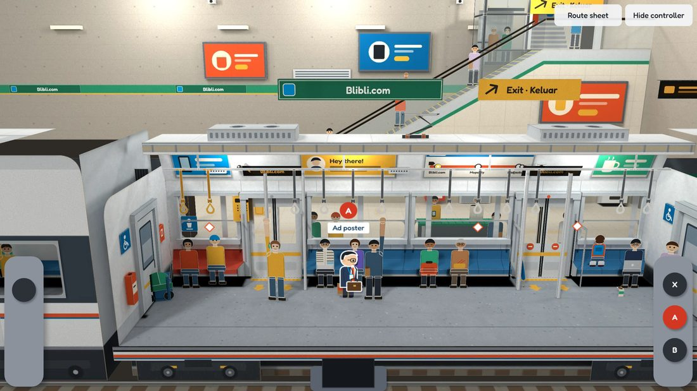

*Don't. Before: straps hang across the signs.*

*Do. After: straps shortened and moved clear.*

### 5.4 Unnecessary posters and duplicated ones are removed.

- [ ] **Said.** Said about the MRT car and platform.
- Passes:
  - The MRT you accepted with "Looks good": one exit sign over the exit, one line map, no adverts.
- Fails:
  - Phone and coffee adverts repeated in the car; two exit signs; the same lightbox on two walls.
- *Reading, to be confirmed:* My test: a poster or sign stays only if it names the place, directs the player or tells the project, and no design appears twice in one view.

> Reduce unnecessary posters and duplicated one.
>
> (MRT scene 2, 7 Nov)

### 5.5 Nothing stands in the foreground that you would have removed.

- [ ] **Reading.** You had one bench near the foreground of the promenade removed and gave no reason. The standard you adopted also asks for a little framing along the front edge, so I cannot tell what was wrong with the bench. See question 13.
- Fails:
  - The bench in the foreground of the promenade.
- *Reading, to be confirmed:* My guess: props at the front edge stay low and few, so they do not crowd the walk area.

> also remove the bench near foreground
>
> (Papercraft Game Scene 3, 7-12 Nov)

### 5.6 The objects and the container blend: relief ties what stands in the scene to the bounds.

- [ ] **Said.** Freestanding objects, relief and the box surfaces look like one build. Relief on the bounds is what joins them (items 2.4 and 2.6).
- Passes:
  - A bench under a shop window; a stall built out from a facade.
- Fails:
  - Objects standing in front of blank walls.

> minimum use of relief papercraft object to add cohesiveness with bound surfaces, especially if the bounds are designed for enclosed views like walls, near-buildings, etc
>
> (Papercraft Game Scene 2, 6-7 Nov)

## 6. Characters

People are flat on purpose: one cut sheet each, in one family, funny and short, with real character in their faces.

### 6.1 Every person is one cut sheet at short, funny, Paper-Mario-like proportions.

- [ ] **Said.** Passers-by are drawn like the player: single sheets, shorter than before, funny, Paper-Mario-like.
- Passes:
  - The Blibli cast.
- Fails:
  - Tall, thin, realistic figures.
  - Passers-by in a different style from the player.
- *Reading, to be confirmed:* The design you then accepted has a big round head close to half the figure's height, a short body, stubby legs and the white paper edge all round.

> The single-sheet humans or characters design should be similar to the playable character. Shorter than current model, and funny Paper-Mario-like.
>
> (Papercraft Game Scene 3, 7-12 Nov)

*Do. The accepted player and passers-by.*

### 6.2 The player is a bored salaryman with a clean short Japanese haircut, and is not cute.

- [ ] **Approved.** A suit, a loosened tie, a briefcase, heavy lids, a flat mouth, a clean short side-parted cut. He is a salaryman, not a mailman or courier.
- Passes:
  - The player as accepted on 7 Nov ("Yes, meets it").
- Fails:
  - A cheerful courier with a mail bag.
  - A cute face with big sparkling eyes.

> I want to redesign the playable character as salaryman with Japanese clean short hairstyle
>
> (Papercraft Game Scene 3, 7-12 Nov)

> The main character shouldn't be cute. It should be bored salaryman
>
> (Papercraft Game Scene 3, 7-12 Nov)

> I want to reframe the character as salaryman, not mailman.
>
> (MRT scene, 6 Nov)

### 6.3 Faces are in the Gaia Online avatar style, drawn crisply, with small eyes.

- [ ] **Approved.** You first asked for the Pico World face style, then changed to Gaia Online "in paper mario higher resolution". Your one correction to the result was the eye size; after that, "Yes, meets it".
- Passes:
  - Eyes at about 70% of the first attempt.
- Fails:
  - Large eyes.

> Changed my mind. Use gaia online face style, but in paper mario higher resolution
>
> (Papercraft Game Scene 3, 7-12 Nov)

> Make the eyes smaller
>
> (Papercraft Game Scene 3, 7-12 Nov)

### 6.4 There are three builds, and the player is the average one.

- [ ] **Said.** Short is the base. Average has slightly longer legs and body. Big is slightly taller and broader than average, for big, energetic characters.
- Passes:
  - The child and the sun-hat lady short; the player average; the father and the hawker big.
- Fails:
  - Everyone the same height.

> Support 3 character height. Short: current height, (2) average: Slightly lengthen the leg and body. (3) big characters: slightly taller and bigger than average, for big and energetic characters.
>
> (Papercraft Game Scene 3, 7-12 Nov)

> The playable character is average height
>
> (Papercraft Game Scene 3, 7-12 Nov)

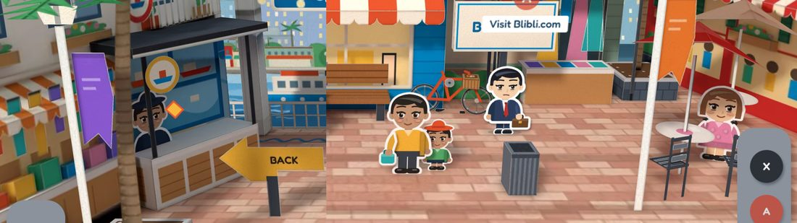

*Do. The three builds.*

### 6.5 Each passer-by has their own expression; nobody shares one stock cheeky smile.

- [ ] **Approved.** A cast, the way Paper Mario has one: grumpy, determined, surprised, cool, sleepy, shouting. Blush only where it suits the face.
- Passes:
  - The seven expressions on the Blibli street, accepted with "Yes, meets it".
- Fails:
  - Every passer-by with the same open eyes, small smile and blush.

> I personally don't like the cheeky facials of NPC. Add more facial expressions like Paper Mario.
>
> (Papercraft Game Scene 3, 7-12 Nov)

*Don't. Before: one cheerful face on everyone.*

*Do. After: each has their own expression.*

### 6.6 No character is hidden by the furniture they stand behind.

- [ ] **Said.** Anyone behind a counter or a rail is raised or moved until their head and shoulders show.
- Passes:
  - The hawker on a step behind his kiosk counter.
- Fails:
  - A seller shorter than his counter.

> Also the hawker merchant cannot be seen now
>
> (Papercraft Game Scene 3, 7-12 Nov)

## 7. Telling the project

The scene says what the project is through a place and things to do in it. It is not written out, not shown on a screen, not turned into a puzzle, and not hidden in a far-fetched metaphor.

### 7.1 The project is told by the scene and by interaction, not by text or screenshots.

- [ ] **Said.** No paragraph describing the project and no screenshot of it in the scene.
- Passes:
  - For Sale and For Rent signs on properties.
  - A catalog leaflet beside the showcased phone that opens to the product spec.
- Fails:
  - A panel of text explaining the project.
  - Screenshots of the website on a wall.
- *Reading, to be confirmed:* The letter changed over time. On 31 Oct it was to show "role and project descriptions, no pictures". On 6 Nov you said to remove textual description of the projects. I kept one note about your role in the Blibli mailbox, asked, and got no answer. See question 14.

> Tell the story from scene and interaction, not by text description, e.g by adding For Sale / For Rent posters on some properties in the scene
>
> (Downtown, 6-7 Nov)

> Remove textual description and screenshots about the projects. Encode them in the scene and interactions, e.g view product spec by clicking on catalog paper beside showcased smartphone
>
> (Papercraft Game Scene, 6 Nov)

### 7.2 Each interactive object has its own interaction, and that interaction carries one fact.

- [ ] **Said.** Different objects do different things, and what each does stands for something true about the project.
- Passes:
  - Your examples: a computer that rates the product in the tray with stars; a mailbox whose letter pulls out and is shown close up; a catalog paper that shows the product detail.
- Fails:
  - Every stop opening the same kind of letter.
- Attempts the owner has not judged yet:
  - A home whose front swings open to show its rooms.

> Come up with unique interactions for different papercraft objects to convey or represent the message.
>
> (Joy-Con portfolio TV game, 31 Oct)

### 7.3 The product is not shown literally, such as its website on a phone or a screen.

- [ ] **Said.** A device showing the app would work for any project, so it says nothing particular and is not creative.
- Passes:
  - Homes with sale and rent signs for a property app.
- Fails:
  - The salaryman holding up a phone that shows the Moperty app.
  - A street poster with a lit screen showing the website.

> In scene interaction is allowed, but don't express it literally, e.g opening moperty website in a phone. If we go this way, then this apply to all project and it is not creative
>
> (Moperty session, 12-13 Nov)

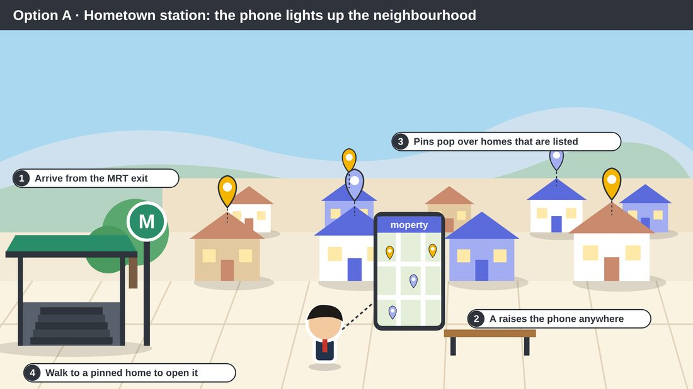

*Don't. Rejected sketch: the app on a phone.*

### 7.4 The metaphor is not so far from the product that it has to be explained.

- [ ] **Said.** The scene should still plainly be about the project's subject. Animals and their homes standing in for people and property is too far.
- Fails:
  - A tree of birdhouses with birds looking for a home.
- Attempts the owner has not judged yet:
  - Real homes on a hometown green.
- *Reading, to be confirmed:* I rule out other stand-ins of the same kind too, such as shells and hermit crabs. My test: the project's real subject is physically present in the scene (homes for a property app, goods for a shop).

> Bird tree metaphor is too far
>
> (Moperty session, 12-13 Nov)

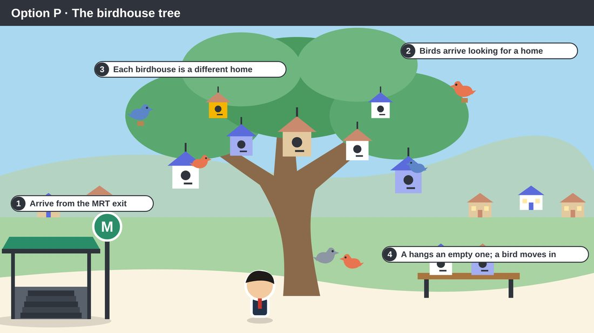

*Don't. Rejected sketch: the birdhouse tree.*

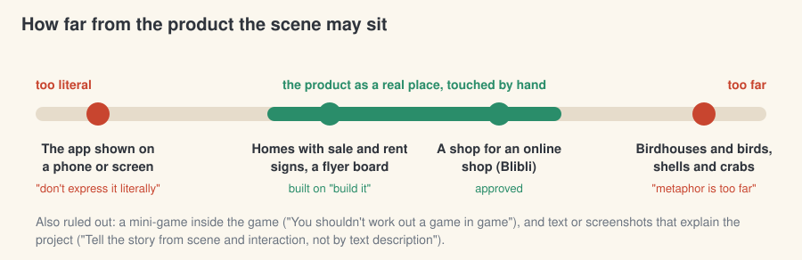

*Reference. Where the accepted ideas sit between too literal and too far.*

### 7.5 The scene does not turn the product into a game inside the game.

- [ ] **Said.** Said when I proposed raising a phone to reveal pins over homes and filtering them by sale or rent.
- Fails:
  - The proposal above.
- Attempts the owner has not judged yet:
  - Pressing A once to swing a home open.
- *Reading, to be confirmed:* My test: one press, one visible result, nothing to remember or combine. On 31 Oct you wrote "treat each work page as a game in itself" and asked for a unique interaction per object; I take the later sentence as limiting mechanics, not interactions. See question 15.

> You shouldn't work out a game in game
>
> (Moperty session, 12-13 Nov)

### 7.6 For Moperty, only the product is shown; the technology is left out.

- [ ] **Said.** Nothing about the tech stack or how it was built: no tech labels, no crane building "backend" and "frontend" floors, no drawing board for the UI design.
- Fails:
  - A site board listing Vue, Laravel and Postgres.
- Attempts the owner has not judged yet:
  - Homes, signs and a flyer board, with no tech labels.

> I only want to encode the product onto the scene. Leave out encoding tech details, they are not necessary.
>
> (Moperty session, 12-13 Nov)

### 7.7 For Moperty, the scene is a single space, either indoor or outdoor.

- [ ] **Said.** One space, not a street plus rooms.
- Fails:
  - A street with a sales gallery you enter.
- Attempts the owner has not judged yet:
  - One outdoor green.

> I want only a single space, either indoor or outdoor, no need both.
>
> (Moperty session, 12-13 Nov)

### 7.8 The game starts in the MRT; each project is a stop the salaryman walks out at.

- [ ] **Said.** Home is the character inside the train. A project scene is the destination of the chosen stop. A project can be the scene itself (as Blibli is) or an interaction within a scene.
- Passes:
  - Choosing a station on the line map, the doors opening, walking out (the MRT you accepted).
- *Reading, to be confirmed:* Two things are unsettled. Your first brief said "a moving train"; the MRT you accepted stands in a station, and you have not said whether it should still move (question 16). And your phone example is ruled out by 7.3; whether a map is still acceptable is question 17.

> The landing / home scene is the character inside a moving train or MRT. The destination is the specific work scenes. Character walk out of MRT when arriving at destination (selected stop)
>
> (MRT scene, 6 Nov)

> The concept of the game starts from MRT scene... Then we can go to many destinations. Moperty either can be expressed as the scene itself (like blibli in papercraft game scene 3 session), or interaction within a scene (like viewing a phone or map). Regardless, an initial scene is needed as the MRT train destination
>
> (Moperty session, 12-13 Nov)

### 7.9 All text in the scene is in English.

- [ ] **Said.** Signs, maps and labels use English only.
- Passes:
  - "Exit".
- Fails:
  - "Exit · Keluar".

> Use only English language.
>
> (MRT scene 2, 7 Nov)

### 7.10 The MRT platform carries a complete network map.

- [ ] **Said.** Said about the MRT platform.
- Passes:
  - The map in the MRT you accepted: four lines, interchanges and fifteen named stations including Blibli.com, Moperty and Radjastone.

> Also put More complete version of MRT map on the platform walls.
>
> (MRT scene 2, 7 Nov)

### 7.11 The place as a whole stands for the work, and not every section of the old page is carried into it.

- [ ] **Said.** The environment and its objects represent the overall work. A scene does not need a stop for every section of the existing work page.
- Fails:
  - Porting every paragraph and screenshot of the old page into stops.

> The indoor environment and its objects represent the overall work.
>
> (Joy-Con portfolio TV game, 31 Oct)

> Showing the screenshots are not required, they can be removed. Not every section in existing work page should be ported
>
> (Joy-Con portfolio TV game, 31 Oct)

## 8. Scene briefs you have given

What you have asked each scene to be. A scene is checked against its own brief as well as the general checks.

### 8.1 Blibli: a store in a walkable riverside shopping centre, with the river visible.

- [ ] **Said.** Outdoors: a riverside or bayside shopping centre with a rich mix of structures such as hawker stalls, trees and another store; a mailbox and stacked delivery boxes outside the store. Indoors: the first floor is a smartphone showcase standing for the product detail project; the second floor is a storage room standing for the product review project.
- Passes:
  - The Blibli promenade you accepted on 12 Nov.
- Attempts the owner has not judged yet:
  - The outlet and the store-room as they stand.

> I want the scene to be located in a walkable outdoor bayside / riverside shopping center like in the picture, with rich combination of structures and objects like hawker stalls, trees, another store, etc. The river should be visible.
>
> (Papercraft Game Scene 2, 6-7 Nov)

> The store building is located in shopping street. The first floor is smartphone showcase, representing the product detail project. The second floor is storage room, representing product review project.
>
> (Papercraft Game Scene, 6 Nov)

> Blibli work scene have a mailbox and delivery package boxes stacked outside the store.
>
> (Joy-Con portfolio TV game, 31 Oct)

*Do. The accepted Blibli promenade.*

### 8.2 MRT: an end car of the train, cut open, standing in an underground station that surrounds it.

- [ ] **Said.** The playable area is inside the car. The view is the same train perspective as before. The station is all around the car, not only seen through its windows. The strip at the bottom of the frame is the car's wheels, not a full-width track. The car is the last or first car. The platform is deep enough for the escalator and elevators to the exit.
- Passes:
  - The MRT you accepted with "Looks good".
- Fails:
  - A station that exists only as a view through the car's windows.
  - A band of rails and sleepers across the whole bottom of the frame.

> I want to put the train in an underground station. The playable area is inside the train
>
> (MRT scene 2, 7 Nov)

> I want to keep the same train perspective as in current box scene, but put the train in a station inside. The station is not only visible through the train windows.
>
> (MRT scene 2, 7 Nov)

> Then it should be the wheels. The tracks are visible on both sides of the car anyway.
>
> (MRT scene 2, 7 Nov)

> the train is the last / first car
>
> (MRT scene 2, 7 Nov)

*Do. The accepted MRT.*

### 8.3 Moperty: one space that shows only the product, reached as an MRT destination.

- [ ] **Said.** See 7.3 to 7.8. Earlier, for the downtown concept, you also asked for a building resembling the Moperty logo and colours that reflect the logo "but add depth and details". You have not said whether that still holds for the new concept.
- Attempts the owner has not judged yet:
  - The hometown green.
- *Reading, to be confirmed:* I have kept the logo's indigo, lavender and yellow as the hometown's accent colours and dropped the logo building. See question 18.

> Also add a building resembling the Moperty logo.
>
> (Downtown, 6-7 Nov)

> colors should reflect the logo, but add depth and details.
>
> (Downtown, 6-7 Nov)

### 8.4 Radjastone: starts from nature and architecture.

- [ ] **Said.** Your starting idea, given with "Replace these if you have stronger ones" in the prompt you adopted. Not built yet.

> shopping-themed scene for blibli, maps or towns for moperty, nature and architectures for radjastone.
>
> (Joy-Con portfolio TV game, 31 Oct)

### 8.5 Every scene is the TV layer of a console, under a controller layer that can be hidden, and the player moves freely in it.

- [ ] **Said.** The scene fills the screen as the TV. The controller sits on its own layer and can be shown or hidden, so the scene must read with it in either state. Movement is free, not along fixed roads.

> I imagine the full screen background as a TV screen, while the controller is on different layer. there is a toggle to hide or show the controller layer. Both layers are 2.5d style.
>
> (Joy-Con portfolio TV game, 31 Oct)

> You can obviously do free movement.
>
> (Joy-Con portfolio TV game, 31 Oct)

## 9. Paper look, light and performance

Fewer of these are in your own words. Where a point comes from a standard I wrote and you adopted, it says so.

### 9.1 The look is inspired by Paper Mario, with original art.

- [ ] **Said.** A 2.5D paper world. "No Nintendo assets" comes from the prompt I drafted and you adopted on 31 Oct.
- Passes:
  - Original figures at Paper Mario proportions.
- Fails:
  - Copied sprites.

> papercraft objects for my 2.5d interactive portfolio site that is inspired by Paper Mario design
>
> (Pinewood Valley session, 4 Nov)

> Use original art, marks and sounds, with no Nintendo assets.
>
> (Joy-Con portfolio TV game, 31 Oct, in the prompt you adopted)

### 9.2 Lighting is really computed, so shadows are real.

- [ ] **Reading.** Twice the real light bake needed a download, and both times you allowed it instead of settling for an evenly lit preview. That was a tooling choice. I read it as wanting real shadows.

### 9.3 The scene is clearly paper: grain, cut edges, folds; never photographic.

- [ ] **Reading.** From the standard I wrote and you adopted on 6 Nov ("I want to use this standard"). You have not restated it in your own words.
- Passes:
  - White core edges on coated card; same-colour edges on dyed paper.
- Fails:
  - Photo textures; printed gradients standing in for light.

> I want to use this standard when building scenes for papercraft-game branch.
>
> (Papercraft Game Scene, 6 Nov)

### 9.4 The scene loads and shows.

- [ ] **Said.** A published scene that shows nothing fails everything else.
- Fails:
  - The last Pinewood Valley version, which you reported as blank.

> Nothing is loaded on the Pinewood valley artifact
>
> (Pinewood Valley session, 5 Nov)

### 9.5 The scene runs smoothly on a phone.

- [ ] **Reading.** The prompt you adopted on 31 Oct asks for 60 fps on a mid-range phone. No scene has been measured on a real phone, and you have never said whether richness or frame rate wins when they conflict. See section 10.

> Motion holds 60fps on a throttled mid-range Android profile, with no layout shift.
>
> (Joy-Con portfolio TV game, 31 Oct, in the prompt you adopted)

## 10. How you want the work done

These are about how I should work with you on a scene, taken from what you asked for or stopped me doing.

### 10.1 Before building, I restate your standard or feedback in my own words.

- [ ] **Said.** You ask for this at the start of almost every session, and you correct the restatement when it is wrong.

> Before proceeding, restate my feedback using your own words
>
> (Papercraft Game Scene 2, 6-7 Nov)

> The intent is quite inaccurate.
>
> (MRT scene 2, 7 Nov, correcting a restatement)

### 10.2 Options are shown as pictures, in low fidelity, before anything is built.

- [ ] **Said.** Ideas are shown, not described. A rough sketch of each option comes first.
- Fails:
  - Describing three concepts in text only.

> Propose to me few options. show me lower fidelity version of each of those scenes
>
> (Moperty session, 12-13 Nov)

> Show me your design concept
>
> (Moperty session, 12-13 Nov)

### 10.3 I stop and wait for your verdict; I do not keep adding while you are looking.

- [ ] **Said.** Under a loop goal I keep refining against this checklist without asking for a verdict after every pass. I stop adding when you say you are looking, or when you interrupt.
- Fails:
  - Building a v6 draft with more pieces after "Let me take a look first".

> Let me take a look first
>
> (Pinewood Valley session, 5 Nov)

### 10.4 I act on what you mean, not on the most literal reading of one phrase.

- [ ] **Said.** An instruction is an example of an intent. Apply the intent; do not maximise the phrase.
- Fails:
  - Reading "increase the variety of objects" as "add as many kinds of object as possible".

> That is overfitting to the task, not generalizing my intent.
>
> (Pinewood Valley session, 5 Nov)

### 10.5 A scene, and the standard with it, is refined in a loop until you accept it.

- [ ] **Said.** You set a looping goal in nearly every session. One pass followed by a request for review is not what you ask for.

> keep looping to refine the scene until it achieves my standards. keep and maintain the standards in previous sessions too
>
> (Papercraft Game Scene 3, 7-12 Nov)

> keep looping to refine the scene and standards until it achieved my standards
>
> (Start of Downtown 2, 7 Nov)

### 10.6 Standards from earlier sessions still apply.

- [ ] **Said.** A new session inherits every earlier standard unless you change it.

> keep and maintain the standards in previous sessions too
>
> (Papercraft Game Scene 3, 7-12 Nov)

### 10.7 Drafts and stray versions are cleaned up.

- [ ] **Said.** Abandoned artifacts and drafts are removed when you say so.

> remove the Jungle Camp and Shoebox Camp v6 artifacts
>
> (Pinewood Valley session, 5 Nov)

## 11. Open questions for the owner

1. **Relief at the sides.** At the start of Downtown 2 you said the first downtown lacked relief on the left, right and back bounds. Downtown 2 added it and was still rejected. For the hometown you said relief buildings on the left and right made it too like Blibli. My reading: enclose the sides only when the place really is enclosed there, and never enclose two scenes the same way. Is that right, or should every outdoor scene have something in relief at its sides?
2. **What "badly designed objects" meant.** In Downtown 2, which objects were badly designed, and what was wrong with them? That build used the fox and pine recipe for its trees, dog and pigeons, so the recipe alone did not satisfy you. Check 4.8 holds my guesses.
3. **What "a mess" meant.** Is my reading in item 5.2 right: one anchor, a few groups, clear ground between them? Or was the Downtown 2 problem something else, such as too many things, clashing colours, or the dusk lighting?
4. **The hometown green.** You have not yet judged the current hometown: homes in the middle, the valley open at both ends, a farm valley behind. Does its background now have enough detail, variation and depth? Is the layout different enough from Blibli?
5. **The MRT structure.** When you said "Remove the MRT structure", did you mean the line across the valley, the exit building on the green, or both? I removed both.
6. **Daytime.** Is "day scene" a rule for every scene, or only for Pinewood Valley?
7. **Product only.** Is "leave out the tech details" a rule for Moperty only, or should the tech parcels in the Blibli street go as well?
8. **Richness against frame rate.** When a richer scene runs slower, which wins? The Blibli street runs at about 18 frames a second in my test container, and none has been measured on your phone.
9. **The folded dog and pigeons.** Tent-folded animals follow the fox recipe, but from the game's low camera the dog is hard to read. Should small animals stay folded, or may they be flat cards?
10. **The reference photos.** I could not retrieve the photos you attached in earlier sessions (the trees example, the layered landscape, the cities and road, the riverside centre). The diagrams marked "stands in for" are my reconstruction from the descriptions. If you can attach them again, I will replace the diagrams with the real images.
11. **The ceiling canopy.** You had Pinewood's ceiling pine canopy removed, and also said a forest canopy can enclose a ceiling. Was the canopy wrong for that scene only, or do you want the top of an outdoor scene open as a rule?
12. **What "layer depth" meant.** When you said the layer depth was "very minimum", did you mean the gap between layers, the number of layers, or how deep the whole stack is?
13. **The bench in the foreground.** Why did the bench near the foreground have to go: was it blocking something, out of place, or badly made?
14. **The role note in the mailbox.** The Blibli mailbox still holds one written note about your role. Should any written note remain in a scene?
15. **Interaction against game.** Where does a "unique interaction" end and a "game in game" begin? My test is one press, one visible result, nothing to remember or combine.
16. **The moving train.** Your first brief said the home scene is inside a moving train. The MRT you accepted stands in a station. Should it move again?
17. **A map for Moperty.** You mentioned "viewing a phone or map" as a possible interaction, then ruled out the phone as too literal. Is a paper map still acceptable?
18. **The Moperty logo.** Does the new Moperty scene still need a building that resembles the logo, and colours that reflect it?
19. **Simple flat objects.** On 31 Oct a single flat piece was fine for "simple objects". Under the three cases you gave on 7 Nov, a simple object standing in the open would have to be folded. Which holds?
20. **What I have not covered.** Twice you introduced a list of faults with "including, but not limited to". This checklist holds only what you have said or accepted so far, so a scene that passes every check may still fall short. What is missing?
