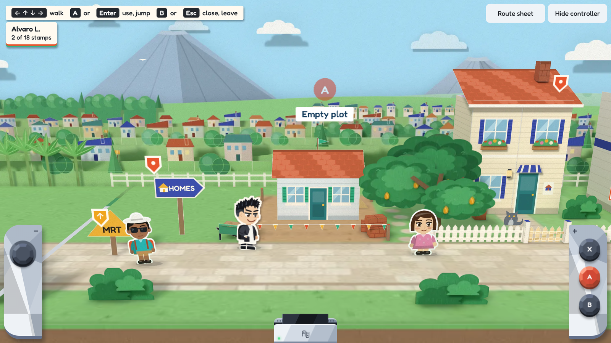
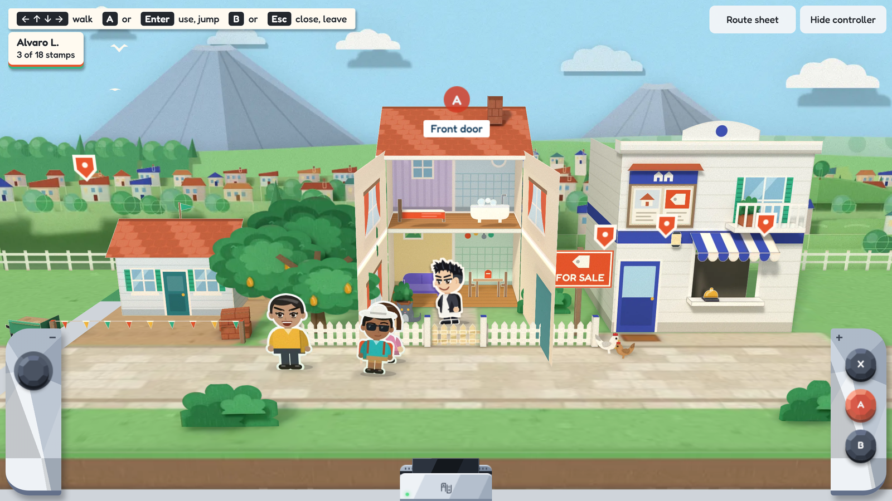
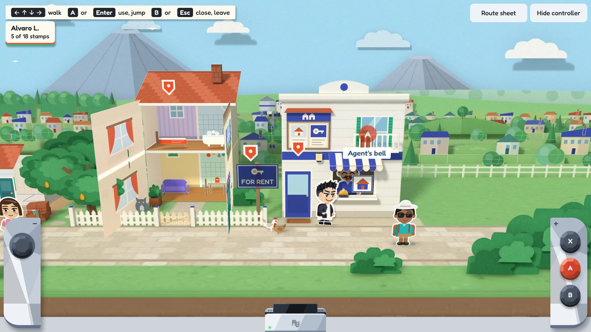

# Moperty: the hometown lane

The design record for the Moperty scene. It was made in three phases, in this order: **mechanics** (the rules), **dynamics** (the rules running in a grey box), **aesthetics** (the paper diorama, by the scene standard). Each phase closes with a review; a phase is ready when its review has nothing open.

## What the scene has to say

From `content.ts` and the live product (moperty.id):

| # | Fact | Source |
|---|---|---|
| F1 | Moperty lets people browse property around my hometown | description |
| F2 | A listing is for sale or for rent | the product |
| F3 | A listing has a detail page: what is inside the property | the product |
| F4 | It lists different kinds of property: land, houses, warehouses | the product's own title |
| F5 | Every listing lets you ask an agent | the product ("Ask") |
| F6 | I built the whole product myself, from the design to the front and the back | summary |
| F7 | I made it findable, and people came | summary (SEO) |
| F8 | It is a side project that still runs | role, the live site |

Nothing about the technology appears in the scene (scene standard 7.6), and nothing is written out (7.1).

## Phase 1: mechanics

### Pillars

1. **A toy, not a level.** No goal, score, timer or fail state. Every interaction can be repeated for ever and undone by doing it again.
2. **One object, one verb, one fact.** No two objects are used the same way (7.2).
3. **What you do stays done and is noticed.** A change at one object is seen by the rest of the lane: the people in it and the office window. This is the scene's signature and the one thing no other scene has.
4. **Paper does it.** Every motion is something a paper model could do: a hinge, a flap, a pop-up, a flip, a slide, in stepped frames.

### The fantasy

You are the one person who runs a small hometown lane of property. You put the homes on the market, and people come to look.

### Verbs

The scene adds no button. It uses the three inputs the game already has, and gives each one more thing to mean.

| Input | Already means | New in this scene |
|---|---|---|
| Stick | Walk | **Presence**: some paper answers him being there (the garden gate opens as he comes to it) |
| A at a stop | Use it | Five toys below, each its own verb |
| A away from a stop | Jump | **Bump**: a jump under something that hangs shakes it loose (the mango tree). **Thump**: landing shakes the small things around him |
| B | Leave | unchanged |
| Tap | Walk there and use | unchanged; a tap on the tree walks him under it and jumps |

### Objects

Left to right along the lane. Each toy is a counter that A steps round (`toys` in `game.ts`).

| Stop | Verb | States | What happens | Fact |
|---|---|---|---|---|
| Way out | walk through | | Back to the MRT | |
| **Road sign** (`post`) | raise | 0 down, 1 up | The fingerpost at the lane's mouth swings up on its hinge. While it is up, visitors walk into the lane (see Visitors). Lowering it sends them home | F7 |
| **Empty plot** (`build`) | build | 0 land, 1 plan, 2 front, 3 back and sides, 4 roof | A pop-up house rises one fold per press: the plan sheet unrolls on the ground, the front stands up, the back and sides stand up, the roof folds over. A fifth press folds it flat: it is a pop-up, and the plot is land again | F6, F4 |
| **Board** (`board`) | flip | 0 for sale, 1 for rent | The board in the house's yard turns over on its post, one face coral, one blue | F2 |
| **Front door** (`door`) | open | 0 shut, 1 open | The front of the house swings open like a doll's house and the rooms inside pop up: bed, bath, living room | F3 |
| **Agent's bell** (`ask`) | ring | 0 nobody, 1 to 3 the agent with a card | The bell hops. The agent pops up in the office window and holds up a picture card: land, a house, a warehouse, one per ring. The fourth ring sends him back down | F5, F4 |
| **Office door** | visit | | Opens moperty.id | F8 |

Not stops, so they carry no marker and no stamp:

| Thing | Trigger | States | What happens |
|---|---|---|---|
| **Garden gate** (`gate`) | presence | 0 shut, 1 open | Swings open while he is at it, shuts behind him |
| **Mango tree** (`mango`) | bump | 0 to 3 mangoes down | A jump under the tree drops a mango. The fourth jump: the hens have eaten them, and the ground is clear again |
| Hens, cat, washing, wheelbarrow, sand heap | brush, thump or tap | | Hop, with a puff of dust or a tag |

### Chain reactions

What makes it a lane and not six buttons. Every row is a rule the dynamics phase must show.

| When | Then |
|---|---|
| `post` goes up | Visitors start to arrive, the first within half a second |
| `post` goes down | Every visitor turns and walks out by the nearer end |
| A visitor reaches a listing | They stop, look and answer with a tag that depends on its state (table below) |
| A toy changes while a visitor is looking at it | That visitor hops and answers again at once, and stays a little longer |
| `door` is open | The house draws visitors before anything else |
| `build` reaches 4 | The hens scatter; the plot's card in the office window turns from land to house |
| `build` folds back to 0 | Dust; the card turns back to land |
| `board` flips | The house's card in the office window changes colour with it |
| `mango` wraps to 0 | The hens peck |
| He lands a jump | Small things within reach hop a little (thump) |

### Visitors

The people who browse (F1, F7). They are scenery that follows rules; nothing is won by them.

- Three visitors. They exist only while `post` is 1.
- **Spots.** Each listing has a viewing spot on the lane: `plot`, `house`, `office`.
- **Choosing.** A visitor goes to the spot with the highest score: appeal, minus 1 for each other visitor at or heading to it, minus 1.5 if they were just there.

  | Spot | Appeal |
  |---|---|
  | plot | 1 as land, 1.5 while it is going up, 2 when built |
  | house | 1.5 shut, 2.5 open |
  | office | 1 with nobody in, 2 with the agent up |

- **Looking.** On arrival they stop for 3 to 5 seconds and answer:

  | Spot | State | Tag |
  |---|---|---|
  | plot | land | ? |
  | plot | going up | … |
  | plot | built | ! |
  | house | shut | ? |
  | house | open | ♥ |
  | office | nobody in | … |
  | office | agent up | ♪ |

- **Moving on.** After three or four looks they leave by the nearer end, wait a few seconds out of sight and come back in the way they left.
- **Places.** Each listing has a set number of places to stand (two at the plot, one at the house and the office). A visitor never heads for a listing with no place free; with nowhere to go they leave.
- **Staying.** The more a listing draws them, the longer they look: from 0.85 of their usual look at a bare plot to 1.3 at an open house.
- **Brushed** by the salaryman they hop and answer, like any passer-by.
- Under reduced motion nobody walks: while `post` is up, one visitor stands at each spot.

### What was left out, and why

| Idea | Why not |
|---|---|
| Carrying a key or a sign from one object to another | Order dependencies turn a toy into a task (7.5) |
| A phone or map that filters listings | Literal, and already ruled out (7.3, 7.5) |
| "Sold" stickers, prices, counts | Not in the source; never print what `content.ts` does not state |
| Labels for design, front end, back end, SEO | Technology (7.6). The build order (plan, front, back) is left for those who see it |
| Installing the app (PWA) | Technology |
| A written summary letter and a tech-stack letter | 7.1, 7.6. The world keeps its `description` for the route sheet |

### Review 1 (rules on paper)

| Check | Result |
|---|---|
| Each fact F1 to F8 has a place | F1 the lane and its visitors; F2 board; F3 door; F4 plot, agent's cards; F5 bell; F6 plot; F7 road sign; F8 office door |
| 7.2 no two stops share a verb | raise, build, flip, open, ring, visit |
| 7.5 not gamified | No goal or score; visitors are scenery. The stamp card is the game's own |
| Every toy reversible | All cyclic |
| No order dependency | Each toy works from a cold start; chain reactions only add |
| Reduced motion | Every state is a still pose; visitors stand |
| Deep links | Every stop has `/round/moperty/<stop>` |
| First ten seconds | He arrives at the road sign: the first A fills the lane with people |

### Review 2 (rules in simulation)

`npm run rules` (`tools/design/lane-rules.ts`) steps the reducer and the crowd without a page: 20 checks, one for every rule above that does not need paper to show it. It found one fault in the first draft (a visitor could take a place another still held) and one in the layout (a viewing spot in front of the road sign); both are fixed.

Pacing, measured over three minutes of simulated lane with the sign up:

| Measure | First draft | Tuned |
|---|---|---|
| Visitors on screen, average | 2.3 | 2.6 |
| Visitors looking at a listing, average | 0.9 | 1.3 |
| Lane empty | 1.1% of the time, 2.0s at most | 0.8%, 1.4s |
| First visitor walks in | 0.35s | 0.35s |
| First look | 5.9s | 4.7s |
| Share of looks at the house, shut then open | 34% then 45% | 35% then 43% |

The first draft walked too much and looked too little, and looking is where the reactions are. Walking speed went up by a quarter, the lane's ends came in, looks grew by half a second and each visit by one listing.

**Phase 1 is ready.** Open for the dynamics phase to answer by play, not on paper: whether five presses to build feels like a build or like a chore; whether visitors in the foreground get in the way of what is being used; whether the office window's cards are noticed at all.

## Phase 2: dynamics

The rules were built into the game and played in a grey box: every piece that moves, at its true size and place, cut from plain card with no print (`src/art/scenes/lane.ts`, baked with `PAPER_PREVIEW=1`). The grey box runs on the real paper renderer, so what was tuned here is what the art pass inherits.

### What the engine learned

Each is general: any scene can use it.

| New | Where | For |
|---|---|---|
| Hinges that turn as hinges at any angle, with a `delay` and a `spring` (five held frames that pass the pose and settle) | `Motion` in `kit.ts`, `fold.tsx` | Walls folding up, the house's leaves, furniture standing up one after another |
| `edge: 'mid'`: a sheet turning over about its middle | `Motion` | The board |
| `Show.drop` and `Show.fold`: a piece that falls in from a height, and one that folds flat to the ground as it goes | `kit.ts`, `fold.tsx` | The roof, the mangoes; the pop-up house closing |
| Bumps: a jump under one steps its toy; a tap walks him under it and jumps | `schema.ts`, `App.tsx` | The mango tree |
| Zones: a toy held at 1 while he stands inside | `schema.ts`, `App.tsx` | The garden gate |
| Thump: landing a jump hops the small things around him | `fx.ts` | Hens, wheelbarrow |
| Reactions: a toy's change plays a hop, a tag, dust or scraps somewhere else | `ambient.ts`, `Scene.tsx` | Every row of the chain-reaction table |
| Actors: baked figures the game moves itself | `kit.ts`, `fold.tsx`, `App.tsx` | The visitors |
| Yards: a tap across a fence walks him round by the gate | `schema.ts`, `walker.ts` | The front door |

### What play changed

Found by playing the grey box, not on paper.

| Found | Change |
|---|---|
| Standing at a stop, he hid the thing he was using | He stands beside every toy and the camera looks at the toy (`look`). A rule check now fails if a stop puts him in front of its object |
| The houses were smaller than he is | The listed house is two storeys, so its upstairs rooms open clear of his head; the pop-up house is a full single storey |
| The pop-up's sheet spilled over the lane and the neighbours when laid flat | The plan is the floor and the front wall only. The back and the gabled sides rise through slots in the ground instead of unfolding outward |
| The roof waiting on the ground cluttered the plot | It is put on from above on the fourth press, with a pennant |
| The built house vanished on the fifth press | It folds flat to the ground in three frames, then the dust |
| A tap on the front door walked him into the fence | Yards: he goes round by the gate, which opens for him and shuts behind |
| The lane's back edge had a step in it that caught him | One straight edge from the plot to the gate |
| Two visitors could be sent to a listing with one place; with every place taken a visitor picked the least bad one | Places are a hard rule; with nowhere to go they leave |
| With one place at the house, an open door changed nothing over time | Visitors stay longer at what draws them more. Looks at the house rise by 28% when it is open, and the whole lane holds more lookers the more of it is in use (1.08 on average with nothing done, 1.27 with everything) |
| Labels and prompts sat on top of the thing used | `mark` lifts them over the plot's roof, the house's eaves and the board |
| At the bell he covered the agent | He stands to the left of the window; the visitors' place is to its right |

### Timing

All motion is held frames, never a smooth ease.

| Moment | Time |
|---|---|
| A is pressed: he dips and scraps fly | same frame |
| A hinge with a spring | 0.5s: five frames, 14% past the pose, back 6% short, settled |
| Sides and back of the pop-up after the press | 0, 60 and 120ms apart |
| Furniture after the leaves start to open | 160, 240, 320 and 400ms |
| A piece that drops in (roof, pennant, mango) | 0.42s in five frames, from 150 to 190 units up |
| The pop-up folding away | 0.3s |
| First visitor after the sign goes up | 0.35s to walk in, about 5s to the first look |
| A visitor's look | 3 to 7s, by visitor and by what they are looking at |

### Review 3 (played)

| Check | Result |
|---|---|
| Every row of the chain-reaction table is shown by paper | Six browser checks in `tests/journey.mjs` (visitors, build, board, gate and house and agent, mango, reduced motion) |
| The rest of the game still passes | The journey suite passes with the lane added to the quad-budget and tap-area checks |
| Five presses to build: a build or a chore? | A build. Each press is a different and larger change, and the whole takes about three seconds |
| Do visitors get in the way? | No longer: no viewing place is in front of a toy or of where he stands to use one, and a rule check holds that. They do cross in front of him as they walk by, as passers-by do |
| Are the office cards noticed? | From the board, on a wide screen, yes: the card turns at the edge of the view. On a phone it is something to find later. Kept: it costs four sheets |
| Portrait and touch | Plays; taps walk him to every toy, the gate route included |
| Reduced motion | Every toy steps with no fold; visitors stand at the listings |

**Phase 2 is ready.** Handed to the art pass: the stops, sizes, poses and timings above are fixed; the lane's two ends need something tall for visitors to come out from behind; the camera needs its height set once there is a background to frame.

## Phase 3: aesthetics

Planned by the nine steps of the scene standard before anything was drawn.

### 1. Container

A ridge-top lane. The lane runs along the top of a rise above the hometown; the ground falls away behind it, so the whole back of the scene is one open view and the homes stand free against it. The container is wide and shallow at the front and very deep at the back. Neither side is walled: the lane runs on past both ends.

### 2. Plan of the main structures

```
far backdrop     sky · clouds · two volcanoes · far ridges                      flat layers (CSS)
mid card         the town: roofs, a water tower, fields, tree lines             flat layers on a card
near card        treetops and near roofs rising from below the ridge, a road    flat layers on a card
ridge edge  -----railing-----gap for the path------------railing---------------
                 [ plot ]    path   [ yard: mango · HOUSE · board ]   [ OFFICE ]   freestanding
verge       sign  barrow   bricks   fence · gate · fence      hens
lane        ==============================================================  walk
front edge  planting clump                                         planting clump
            x -700                       0                              +740
```

| Structure | Kind |
|---|---|
| The house, the office, the pop-up house, the tree, the fence, the plot's kit | Freestanding, folded |
| The road sign, the board, the fence's pickets, the railing | Flat: plane-shaped things |
| Window frames, shutters, awnings, the balcony, lamps, the listings board | Relief on the two buildings |
| Everything beyond the ridge edge | Open view: flat cut layers |

Against the other scenes (1.8): the promenade is a plaza closed by relief shops left, right and back with one gap at the back left; the train is a cutaway car. The lane is closed on no side, its open view runs the full width behind freestanding homes, and its signature is the pop-up house and the people who come.

### 3. The ground

The lane is level so it can be walked. The verge behind it is grass; the plot is bare earth; the yard is paved to the door. Past the homes the ground ends at a railing and drops. The main space continues into the view (3.8) by the path between the plot and the yard: it runs back from the lane to a gap in the railing and goes on as the road that winds down the near card into the town.

### 4. Freestanding objects

| Object | Why it is here | How it is made |
|---|---|---|
| Pop-up house | The thing he built | Floor and front on one sheet, hinged; back and gabled sides through slots; a folded roof |
| Sand heap, brick stack, wheelbarrow, stakes and string | A plot about to be built on | Folded cone; folded boxes; folded tray on a wheel disc; posts with cut pennants |
| The house | The listing | A box open at the front, two hinged leaves, a folded roof, floors as slabs, furniture as stand-up cards on tabs |
| Fence and gate | A yard on a lane | Cut pickets on rails; the gate a hinged leaf |
| Mango tree | A yard tree where he comes from | Forked trunk, scalloped clusters at different depths and greens, fruit glued on; fallen mangoes as crossed pairs |
| Hens | They walk such lanes | Tent fold with comb, wing and tail glued on |
| Office | Where the agent is | A shophouse box: shopfront below, a balcony above, a folded roof |
| Planting clumps at the lane's ends | The edge of the lane; visitors come out from behind them | Bush sheets in layers, a banana plant of cut leaves |

### 5. The open view, front to back

1. The railing along the ridge edge.
2. Near card: crowns of trees growing below the ridge, in two kinds and two tones.
3. The nearest roofs of the town, each different, two with a sale or rent sign.
4. The road from the lane's path, winding down between them, with a row of posts.
5. A banana grove sweeping in from the left and stopping.
6. Mid card: paddy fields as striped patches.
7. A tree line that covers only half the width.
8. The town's middle: roofs in rows, a water tower, a school with a flag.
9. A rounded mound with a single tree, not spanning the width.
10. Far backdrop: a long ridge with woods on part of it.
11. A hamlet on that ridge's slope.
12. A second, paler ridge sweeping in from the right.
13. Two volcano cones, faceted, one lit face and one shaded.
14. Two rows of cut clouds.

### 6. Relief

The lane is enclosed on no side, so relief sits only on its two buildings: shutters, frames, an awning over the door and a lamp on the house's leaves; on the office an awning over the counter, the sill and bell, a balcony with pots, a wall lamp, and the listings board.

### 7. Characters and sight lines

Three visitors (a short woman in a dress, cheerful; a big man, determined; an average backpacker, cool), the agent (moustache, shouting his wares) on a step behind the counter, and a cat on the fence. Nothing stands between the camera and a toy: the dynamics phase fixed where he and the visitors stand, and a rule check holds it. The tree stands at the yard's left, its crown between the plot and the house and clear of both; the board stands at the yard's right, clear of the house's leaves when they are open.

### 8. How it tells the project

Decided in phase 1 and unchanged. The logo appears once, on the listings board (7.9). The only words are FOR SALE, FOR RENT and HOMES.

### Palette

Sky `#a9dcf2`, grass `#8fc878`, lane paving `#e9dcc3`, earth `#cfa97c`, terracotta roofs `#c8623f`; accents Moperty indigo `#3f51b5` and coral `#e8552d`; neutrals cream `#fff4e2`, picket white `#f7f2e7`.

### Review 4 (against the scene standard)

Checked on screenshots of the baked scene at 1280 by 720, 1720 by 720 and 412 by 915.

| Section | Result |
|---|---|
| 1. One coherent place | One theme: a hometown lane on a rise. Every object is listed in step 4 with its reason. Day scene. The homes are whole: four walls, floors, a roof. Its plan is shared with no other scene |
| 2. Technique by zone | Main space: folded buildings, the pop-up, tree, hens, barrow, bricks. Open view: flat layers on two cards and a far backdrop. Relief only on the two buildings, the lane being enclosed on no side. The ground is level; a raised yard was left out to keep the walk simple |
| 3. The open view | Fourteen layers of different kinds, each with its own detail; houses differ in roof, wall, chimney and windows; the far signs repeat the tag and the key. The path's stones lead to the gap in the railing and the road goes on below it, though from most of the lane the tree or a roof hides the road: the weakest point of the view |
| 4. Freestanding objects | Folded bodies with glued pieces; the hens and barrow turned to the camera; the tree is a forked trunk with clusters at three depths and fruit glued on. Flat only where allowed: signs, fence, railing, people, the cat on the fence, the furniture, which is stand-up card on purpose |
| 5. Placement | Three groups (plot, yard, office) with clear lane between them. He stands beside every toy; no visitor's place is in front of one. One of each sign |
| 6. Characters | Three visitors in three builds and three faces; the agent stands on a step so his head and shoulders clear the sill |
| 7. Telling the project | No paragraph, screenshot or tech. Six verbs for six stops. The mark appears once |
| 8. Paper look | Baked light and shadow from the one sun; cut edges and grain from the stocks. The rooms and the leaves' insides carry their own light, since a doll's house is looked into |

Found on the way and fixed: the tree hid the office door (moved to the yard's left, the board to its right); back-to-back sheets on one plane baked black (set apart); the rooms were dark behind their own roof (they carry light); the visitors were baked under the tree and came out dim (they are baked on the open verge); a tap on a far stop could walk him into the open gate (taps keep to the lane); focus on a stop off screen could scroll the whole view sideways (the view no longer scrolls).

Measured in a cloud container with software rendering, walking with all three visitors out: the lane runs at 27 to 42 frames a second where the promenade runs at 22 to 33. It uses 177 quads of its budget of 190.

**Phase 3 is ready**, with two things left open on purpose: the road below the ridge could be made easier to see, and the frame rate has not been measured on a phone.






